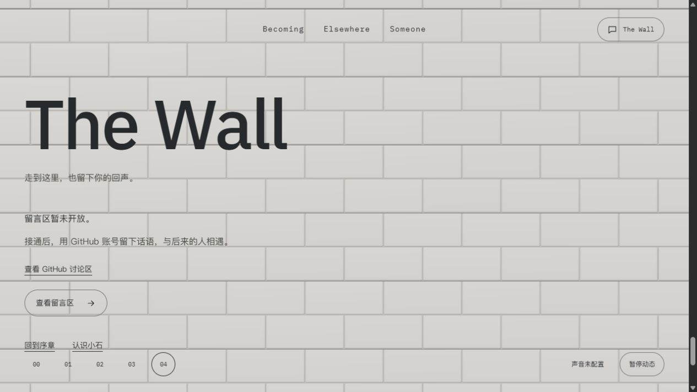
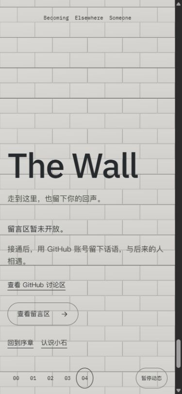

# F02 单砖缩小：执行者交付

2026-10-14 · P01/P14 · R12 · U05 · T03.04。用户指出“单个砖块稍微有点大”。**本机候选已冻结，待独立设计/用户体验**，本片只有一个尺寸变量，F03随后以最新基线接续。

## 固定候选

[4342实际入口](http://127.0.0.1:4342/personal-homepage/#wall) · `HomeJourney.h39_FOLj.js` · 1,173,025 bytes · SHA256 `3217A38DF13E56101D505026E62018A8ECA7A050180B53000A6EE89919F7B0F9`。

[冻结JSON](frozen-candidate.json)保存23源哈希，相对Buuw_zpt只有4份变化、19份保持：wall-assembly.ts、RisingWall.tsx、wall-material.ts、现有测试。没有改三卡顺序、导航、首页玻璃、相机、F03加载或其他栏目，没有提交/部署。

## 尺寸与实现

统一比例`.85`，宽高深、错缝步长、倒角、承托及上移/横移/前移距离同源。最终砖`.952×.408×.136`，步长`.9605/.4165`，倒角`.017`，局部上移`.272`世界单位。材质明暗用除以比例的归一局部坐标，原强度/颜色/灯光保持。底边裁剪按新砖高/承托高的一半，完整墙比例与砖缝同步，整墙没有缩成留黑边的面板。

可见布局依新尺寸重新选行列，继续压紧提交；容量897、两份底边属性7176B、Canvas/target/pass预算不变。因为砖变小，实际完整墙绘制由99/138增加至桌面130/窄屏162；这不是FPS基准，不保证设备帧率。角度、相位算法及3H展开/2H尾段保持，参与行数变化使单位队列覆盖更多砖。

参数唯一来源[SYSTEM9.2.5](../../../../SYSTEM.md#925-全屏扩展与叠层接续)。

## 实际验证

- `tests.log`11/11；已有覆盖用例改为真实缩小步长，并补更高窄屏画幅，要求可见集<200、四角均有承托，不为尺寸配置另写镜像测试。
- `check.log`108文件零诊断；`build.log`15页/Pagefind成功，既有404/chunk提示保留。Impeccable单次限定扫描`detector.json=[]`；限定diff空白检查通过，LF/CRLF提示保留。
- `browser-samples.json`实际同包3份：桌面1280×720阅读完成130砖/13行；桌面砌墙中段build约.53337，77绘制；390×844阅读完成162砖/27行。直接页面截图与DOM分别采集，非原子帧；不以中段截图面积反推其精确build。
- 实际读图墙面四角覆盖、砖尺寸更细，底边显露/错缝与阅读文字正常；同包控制台原始采集见`console.json`。临时标签已关闭，视口已复位。

本次没有再做完整快滚/返回/暂停矩阵或实体手机、系统减少动画、BFCache、WebGL context loss与帧时间测量；旧独立结论不能替代新尺寸样本验收。下一步仅独立设计/用户体验，F03采用此最新候选，不恢复旧大砖或四卡。
