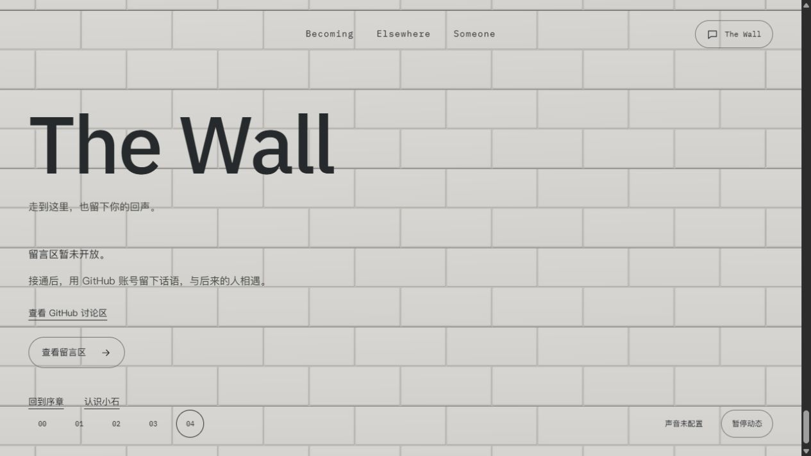
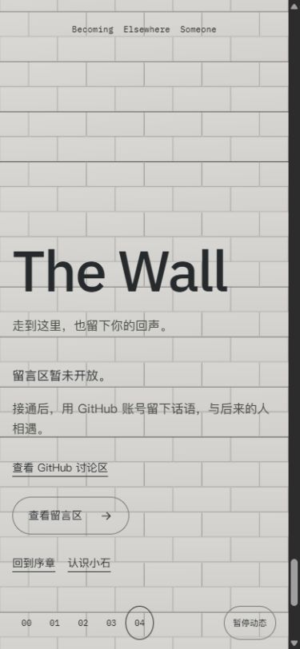

# F02 小砖尺寸：限定独立复核

2026-10-14 · 设计对话 · P01/P14 / R12 / U05 / T03.04。**h39_FOLj 本轮未发现新增阻塞缺陷，可保留并交用户体验；不标记用户审美通过。**本轮只检查尺寸变更及必要回归，没有重做全站或完整 F02 验收矩阵。

## 候选与证据

- 实际入口：`http://127.0.0.1:4342/personal-homepage/?opticsDebug=1#projects`，随后真实滚动与页面控件进入墙。
- 所有首页样本读回组件 `/personal-homepage/_astro/HomeJourney.h39_FOLj.js`。磁盘包 1,173,025 bytes，SHA256 `3217A38DF13E56101D505026E62018A8ECA7A050180B53000A6EE89919F7B0F9`，与工程冻结声明一致；23 源在检查前后均无漂移。
- 本轮核对浏览器加载组件 URL 与磁盘包哈希，未另取得 HTTP 响应体哈希，不能将两者表述为逐字节网络响应确认。见 `candidate-verification.json`。
- `browser-samples.json`、12 份同名 PNG 为独立采集。桌面 1280×720、窄屏 390×844，实际内容宽度 1265/375；均无横向内容溢出。
- 直接 Tab 截图，DOM 状态与截图相邻但并非原子 GPU 帧。滚动仍在平滑收敛时，raw/rendered/portal 读数和截图可能处在相邻时刻；不由截图推断精确时序、输入距离或 FPS。

## 本轮结果

| 检查 | 观察结果 |
| --- | --- |
| 基线 | 末卡仍为 Afterimage、章节 00–04；小砖尺寸未恢复旧四卡，玻璃首屏与局部柔光仍可见 |
| 桌面正向 | 末卡退出→窗口展开→错落砖块从底边显露→完整墙；中段原图可见不同归位高度，砖缝/倒角仍克制 |
| 暂停与恢复 | 中段点击暂停，控件变为继续动态；恢复后继续进入完整墙，无整体墙面跳位 |
| 桌面反向 | 从阅读向上滚回窗口和较低前沿，文字退出、砖块收回；本轮不宣称与正向同一 y 的逐像素一致 |
| 窄屏换向 | 完成墙反向收回，追加下/上滚输入后继续跟随新方向；没有卡死或残留满墙 |
| 完成覆盖 | 桌面 130、窄屏 162 可见实例，四角覆盖；阅读标题、正文、控件对比可辨，缝隙没有因缩砖被拉宽 |
| 返回与刷新 | 窄屏从墙进入 Someone，浏览器后退恢复墙与 nav-about 焦点；刷新 #wall 最终仍为完整墙，未重走全部垒墙 |
| 首屏恢复 | 窄屏点击序章后恢复居中玻璃与批准字标；第12图在 y15 的最后收敛阶段，不能当作 y0 精确静态基准 |
| 日志 | 当前临时标签 0 error、4 warn：3 次 THREE.Clock 弃用提示及1条着色器数值精度提示，原文保留在 console.json |

## 采集异常与限制

- AX 将暂停显示为 checkbox，Playwright DOM 实际为 button；第一次 checkbox 定位无匹配，读回 DOM 后使用真实 button 操作成功。不是应用暂停失败。
- 刷新后第一次等待 `home-wall-ready` 超时；随后读回页面已为 ready/full wall，并保存第11图。保留这个等待边界，不称刷新准备时长已量化或所有等待断言一次通过。
- 没有真机、系统减少动画、WebGL context loss、BFCache 专门分支或帧率/资源压力实测。F03 快慢加载/失败/揭幕验收仍待新功能实现；本轮不挪用历史通过。
- 本轮只读与操作实际页面，未修改应用代码，未重跑构建或额外美术循环。临时标签19已关闭，viewport 已 reset。

## 后续

最新小砖三卡版可作为已授权 F03 的接续基线；若用户再改尺寸或动作，以新反馈优先。F03 完成后另交用户体验，F05/F06/F07继续逐项排队。

上一轮已确认4342 `/gallery/` 为旧 Afterimage 相册占位。本轮 Someone 目标也仍为旧简介占位，这些独立栏目的整合不属于小砖或 F03 已完成范围；应核对各自交付归属，不能擅自覆盖独立栏目源码。

