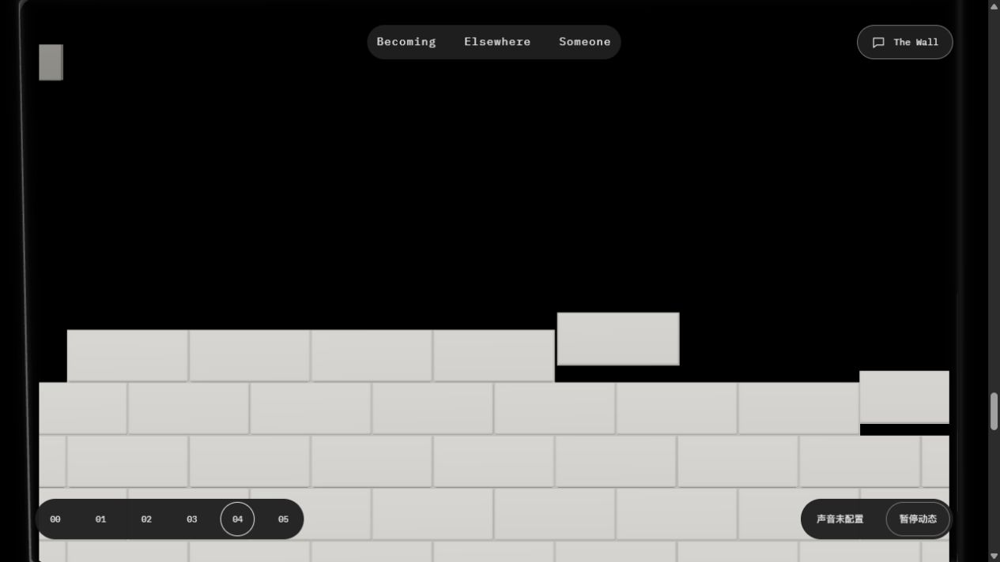
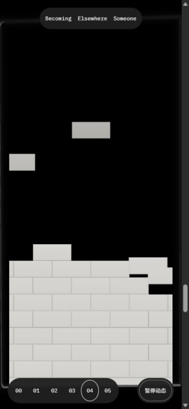

# F02 Quiet Assembly：执行者交付证据

2026-10-14 · P01/P14 · R08/R12 · U05 · T03.04 · Experience。

**状态：本机候选已冻结，待独立设计复核与用户验收。**用户否决CQ-uOU2B的落砖观感后，本批修改节奏、材质与阅读交接；CQ及B2独立结论仅属历史。没有启动F03，没有提交或部署。应用源码冻结清单见[frozen-candidate.json](frozen-candidate.json)。

## 1. 体验入口与定位

- [实际4342入口](http://127.0.0.1:4342/personal-homepage/#links)，刷新后从04慢慢向下滚动；反向滚动可回收已砌墙面。在中段暂停，再继续，观察砖和窗口是否保持连续。
- [诊断入口](http://127.0.0.1:4342/personal-homepage/?debug=1#links)。现有4342预览服务复用，未重启或关闭其他栏目服务。
- 实际包 `HomeJourney.BCioJqmj.js`，1,174,036 bytes，SHA-256 `9D210A639B05A2ECC38A4B99276759809678B5F968BCDA720FC17CD2321F9380`。
- 最终CSS只加深墙面辅助文字，`reading-final.json/png`实际读回`--color-muted:#444740`、阅读背板`display:none`及同一BCioJqmj；没有把CSS确认声称为整套重测。

## 2. 本批判断与实现

原白色矩形悬浮、整齐块群和较深黑洞让画面像方块堆叠。本批表达“暗处的形体进入光里，轻轻回到墙面”：稀疏独立落砖、平缓弧形砌墙前沿、渐进受光、细微姿态归位。具体参数唯一依据为[SYSTEM 9.2.5](../../../../SYSTEM.md#925-全屏扩展与叠层接续)。

- expand由2H改为3H，尾段由1H改为2H；prepare和前四卡距离保持。
- 列相位以偏左低点的平缓曲线排布，跨度2.2；逐砖偏移0→.18，落程.48→.70队列单位。落定仍从底部向上，同列保持承托顺序。
- 飞行亮度由.055逐渐至.34；横移≤.08、俯仰≤.14rad、侧转≤.08rad、前移z=.18→0；全部由进度和固定ID求值，终点精确回原墙体位置，无弹跳。
- 倒角.020/3段；单个标准材质加局部边缘衰减.95→1、上下明暗.94→1.035，承托缝色`#bbb9b3`。一个无阴影pointLight，位置[-3,3.8,4.4]、强度14。属于艺术指导下的局部着色与标准PBR受光，**不声称真实接触阴影或路径追踪**。
- 保留原同一实例墙/窗口/玻璃连续变形，整墙固定[0,0,-1]，完成后不整体上移。去除增强模式阅读板，文字直接落在墙上。

## 3. 新滚动节点

H为实际视口高度，初始间隔100px。prepare为6.5H+100→7.5H+100；expand为7.5H+100→10.5H+100；wall为10.5H+100→12.5H+100。近方门槛e=.42、build算法和四角阅读门禁保持。

| 节点 | 桌面H720 y | 窄屏H844 y |
| --- | ---: | ---: |
| prepare起点 | 4780 | 5586 |
| expand起点 | 5500 | 6430 |
| e=.42近方门槛 | 6407.2 | 7493.44 |
| expand完成 | 7660 | 8962 |
| wall阅读完成 | 9100 | 10650 |

## 4. 当前包实际样本

`browser-samples.json`共24次历史及当前采集；其中14次为BCioJqmj。下面每个标签都有同名PNG和`sample-标签.json`。最后CSS阅读确认单列`reading-final.*`，不重复全矩阵。

| 标签 | y | e / w | 落定 / 在落 |
| --- | ---: | --- | --- |
| compact-desktop-early | 6745 | .576389 / 0 | 3 / 4 |
| compact-desktop-middle | 7282 | .825 / 0 | 38 / 4 |
| compact-desktop-paused | 7282 | .825 / 0 | 38 / 4 |
| compact-desktop-late | 7876 | 1 / .15 | 82 / 4 |
| compact-desktop-reading | 9100 | 1 / 1 | 99 / 0 |
| compact-desktop-reverse | 7282 | .825 / 0 | 38 / 4 |
| compact-mobile-square | 7493 | .419826 / 0 | 0 / 0 |
| compact-mobile-early | 7889 | .576224 / 0 | 6 / 3 |
| compact-mobile-middle | 8456 | .800158 / 0 | 46 / 4 |
| compact-mobile-paused | 8456 | .800158 / 0 | 46 / 4 |
| compact-mobile-late | 9215 | 1 / .149882 | 110 / 2 |
| compact-mobile-reading | 10650 | 1 / 1 | 138 / 0 |
| compact-mobile-reverse | 8456 | .800158 / 0 | 46 / 4 |
| compact-resize-reading | 9100 | 1 / 1 | 99 / 0 |

桌面1280×720（Canvas内容宽1265），窄屏390×844（内容宽375）；仿真视口不是实体手机。正反同进度、暂停保持、完成阅读与手机完成后改回桌面覆盖均有实际样本。临时标签已关闭，视口已复位。

## 5. 有界验证与失败记录

1. 初批`wJmIgMvd`读图发现描边/承托缝过深、砖像瓷砖；一次集中美术修正到`CsOeGnH0`：柔化边缘、提亮缝色、加受光并移除阅读板。旧图保留，不混为最终包。
2. `tests.log`初批8/10：旧单调断言取了两个已经落定的阶段、新侧转终点出现-0。改为实际落程25%/75%检查并确保终点0；`final-tests.log`10/10。后来补可见实例四角覆盖测试，`compact-tests.log`最终11/11。
3. 全897实例仍绘制时，一次重载读DOM超时3秒，后续状态ready；一次阅读进度精确等待超时8秒，随后到达阅读。不能将该批写成无异常，也不能当作FPS测量。
4. 查明未参与画幅的实例仍提交GPU，随后压紧为仅可见参与集，保留原固定ID。完成时桌面绘制99、窄屏138，缓冲容量仍897；两种网格均同样裁剪，没有新增Canvas/目标/pass。完整状态缓存键含宽高，完成后改尺寸仍重新选集，`compact-resize-reading`证实四角覆盖。
5. `compact-check.log`107文件零诊断；该检查后只有完成尺寸缓存键字符串与辅助字色调整。`frozen-build.log`及最终`reading-build.log`均15页/Pagefind成功，保留既有404提示及大chunk警告。
6. `detector.json`一次限定范围Impeccable扫描为空；限定文件`git diff --check`无空白问题，仅既有LF/CRLF提示。扫描通过不代表美术获用户确认。
7. `console.json`与最终`reading-console.json`无error，保留Three.Clock弃用和shader精度warn。最后读取CSS时read-only DOM环境不提供performance，改用实际astro-island的component-url确认包；不是应用错误。

## 6. 边界与交接

6个实现/测试文件变化，14个首页相关源文件与CQ冻结哈希一致；20个当前源哈希记录于冻结JSON。没有改图库/音乐实现，没有恢复光束、光谱、流体、碰撞或音效。

未重新覆盖真机/GPU帧时间、系统减少动画、BFCache、WebGL context loss、全部快滚及Someone返回；这些旧证据不自动升级为本包通过。性能改善只陈述实际绘制集合缩减，不承诺30/60fps。

独立设计复核尚未完成；用户审美尚未通过。下一步仅复核此冻结F02候选并处理明确问题，F03保持排队。
