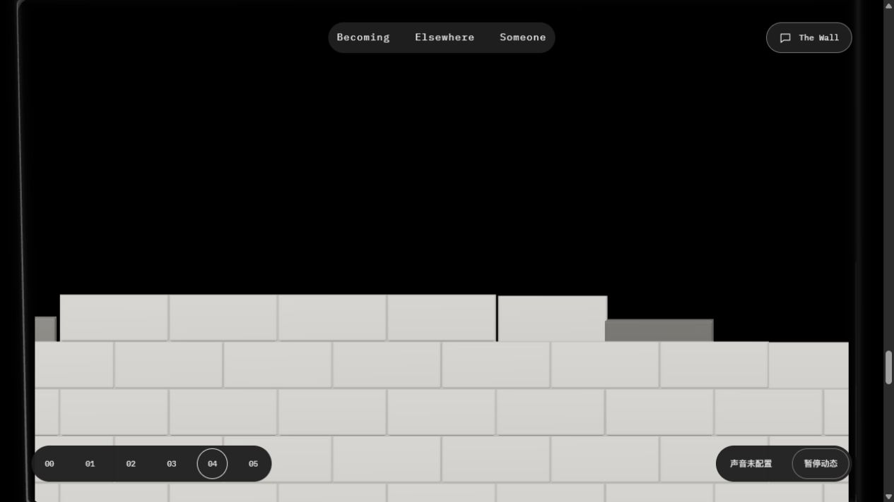
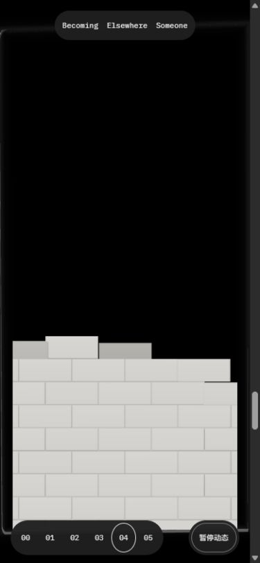

# F02 向上垒墙：执行者交付

2026-10-14 · P01/P14 · R08/R12 · U05 · T03.04。**当前候选冻结，待独立设计复核及用户验收**；未开始F03，未提交或部署。BCioJqmj的独立允许保留结论仅属旧方向。

## 入口与候选

- [用户入口](http://127.0.0.1:4342/personal-homepage/#links)：刷新，从04网站段向下滚动，到近方窗后观察底部逐块垒起；反向滚动可回退，中途可暂停。
- [诊断入口](http://127.0.0.1:4342/personal-homepage/?opticsDebug=1#links)。沿用既有4342服务，未重启其他服务。
- 实际 `HomeJourney.B46QOkX1.js`，1,174,388 bytes，SHA256 `ACFB4CDD9ADA074F31375EAEA4BA9AF57972A44734A43C2493499681722C18B8`。
- 20份源哈希见[frozen-candidate.json](frozen-candidate.json)：4份变化、16份与BC相同。新版只变更`wall-assembly.ts`、`RisingWall.tsx`、`wall-material.ts`和现有测试。材质光照数值、玻璃/四卡/控件/字体/阅读文案及3H/2H滚动范围保持。

## 动作与一次集中修正

用户要求“不从上向下落，直接从下向上垒”。每块砖在最终待砌位置下方.32世界单位生成，按五次smoothstep上移回原位置；同列下一层完全落定才开始上一层，列之间仍错落。姿态回正、受光和固定ID保持。删除从窗口上沿生成砖及随窗口计算spawnY的逻辑，整墙始终固定[0,0,-1]。

首样DSRA6hQX有4份桌面图，发现新砖短暂遮住已砌下层；只做一次集中修正：按每块砖的最终底边进行实例裁剪，砖底为landing.y-.24，承托为landing.y-.245，容差.00001。新砖在基础上沿显露，仍有真实向上位移，无整体扫描遮罩或形体拉伸。两份实例底边浮点缓冲共7,176 bytes，容量897；已有网格材质复用片元discard，不加Canvas、目标、阴影pass或依赖。完成绘制仍桌面99/窄屏138。两材质与几何按原卸载路径dispose。

参数唯一依据为[SYSTEM9.2.5](../../../../SYSTEM.md#925-全屏扩展与叠层接续)。

## 实际样本与方向证据

桌面1280×720，窄屏390×844；内容宽1265/375。`browser-samples.json`共27次，4份旧首样、23份最终包；其中16份与实际阶段对齐，其余7份延迟或收敛采集保留并单列。每份PNG和JSON不是原子帧，JSON的实际y/e/w优先于标签暗示。

| 当前包对齐样本 | 实际y | 已砌 / 动作中 |
| --- | ---: | ---: |
| final-desktop-square | 6408 | 0 / 0 |
| final-desktop-early | 6745 | 3 / 4 |
| final-desktop-middle | 7282 | 38 / 4 |
| final-desktop-rise-a | 7310 | 40 / 5 |
| final-desktop-rise-b | 7340 | 42 / 6 |
| final-desktop-paused | 7340 | 42 / 6 |
| final-desktop-reading | 9100 | 99 / 0 |
| final-desktop-reverse | 7340 | 42 / 6 |
| final-desktop-late-confirmed | 7876 | 82 / 4 |
| final-desktop-reading-confirmed | 9100 | 99 / 0 |
| final-mobile-square | 7494 | 0 / 0 |
| final-mobile-early | 7889 | 6 / 3 |
| final-mobile-middle | 8456 | 46 / 4 |
| final-mobile-paused | 8456 | 46 / 4 |
| final-mobile-late | 9215 | 110 / 2 |
| final-mobile-reading | 10650 | 138 / 0 |

桌面同一砖ID448（row19/column11）在7310→7340时y从-.307554286增加到-.038646259，最终y=0，实际进度.172383→.734294：证明此砖向上接近终点。反向7340采到y=-.037636588，因rendered.e仍在收敛，与正向允许有小差异；不声称逐位相同。两尺寸暂停的共享进度和已砌/动作中数量保持。

新范围没有再变：prepare6.5H+100→7.5H+100，expand→10.5H+100，wall→12.5H+100。桌面近方门槛6407.2/阅读9100；窄屏7493.44/10650。

## 验证及采集限制

- `tests.log`11/11：轨迹单调向上、位移局限待砌位置附近、同列承托先完成、确定性/正反终点、可见集合与四角覆盖等；纯轨迹和测试在底边蒙版修正时没有再改。GLSL由实际浏览器编译/读图验证，不把类型检查说成GLSL验证。
- 首样与修正后的check均108文件零诊断。最终`confirmation-build.log`15页/Pagefind成功；既有大chunk和404提示保留。候选相对BC只增加352 bytes，不当成运行性能测量。
- Impeccable一次限定扫描`detector.json=[]`；限定源码diff空白检查通过（LF/CRLF提示保留）。
- 重载第一次等待发生3秒CDP超时；下一次实际DOM正常，未重载重试循环。阅读精确进度等待有一次deadline超时，但随后9100真实阅读门禁/四角覆盖/99砖正常，控制台采集`console.json=[]`。
- 省掉实际进度等待的批次出现动作后一拍采样：`final-desktop-reverse-lag`及三个`final-mobile-*-lag`有4份，已改名保留，不能作为标签所称阶段通过。恢复实际位置±1px等待后取得上表样本。
- `final-desktop-late`先采到raw.wall=.15而rendered.wall=0；`final-mobile-reverse`采到输入8456但画面仍从完整墙回退中；`final-resize-reading`采到恢复尺寸仍未完成的过渡。三份保留但不作末段、同姿态反向或完成resize通过。后来`final-desktop-late-confirmed`和`final-desktop-reading-confirmed`实际99砖/桌面尺寸/readiness正常。窄屏同姿态反向没有另取稳态确认；已实际回退到early/square。

上述7份不对齐/收敛采集不算应用报错或全部通过，不用工具时延承诺FPS。视口已复位，临时标签已关闭。

未重测实体手机/GPU帧时间、系统减少动画、BFCache、context loss、Someone返回及所有快滚/直达分支；旧BC独立证据不升级为本批通过。新候选待设计侧独立复核与用户审美/使用验收，停止追加美术循环。
