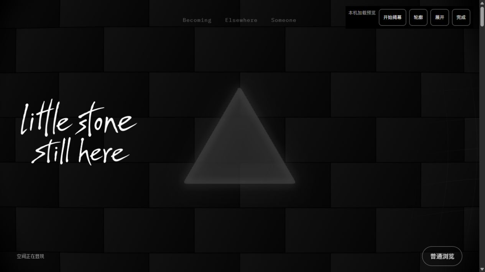
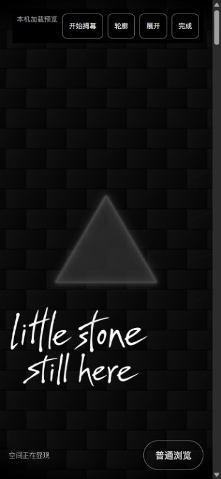

# F03 加载揭幕：限定独立复核

2026-10-14 · 设计对话 · P01 / R12 / U03、U14 / T03.01、T26.02、T27.01。

**结论：本轮实际检查范围内未发现阻塞缺陷，保留 BdZlSJh6，交用户体验；不是用户审美确认。F05/F06/F07不启动。**本次沿用项目指定的单功能、一次集中浏览器复核流程，没有开展全站重设计或额外美术循环。

## 实际候选

- 正常入口：`http://127.0.0.1:4342/personal-homepage/`。
- 重播与阶段入口：`http://127.0.0.1:4342/personal-homepage/?opticsDebug=1&loadingPreview=1`。右上“开始揭幕”播放；阶段按钮只供本机观察，不是正常生产界面。
- 每份首页样本实际组件均为 `/personal-homepage/_astro/HomeJourney.BdZlSJh6.js`。磁盘包 1,183,026 bytes，SHA256 `29864AAAD7A24D0053800A5B73601B235628177E7429BFFE3DC6D702A204D46A`，与冻结清单相符；28源在本次检查前后均无漂移。
- 核对的是浏览器组件URL、磁盘构建与源文件哈希；未单独取得网络响应体哈希。详见 `candidate-verification.json`，不得扩写为逐字节HTTP响应确认。

## 独立证据与结果

`browser-samples.json`和25份同名PNG为本对话独立采集。直接Tab截图，读DOM在截图之前，两个动作不是GPU原子采样。桌面1280×720、窄屏390×844，内容宽1265/375；另在揭幕阶段验证430×932（内容宽415）。全部样本无横向内容溢出。采集标签20已关闭、viewport已reset，未改应用源码或用户存储。

| 范围 | 本轮实际观察 |
| --- | --- |
| 等待、轮廓、软揭幕、结束 | 图01–09。黑底等待、原字标和普通浏览可见；实际玻璃柔边从上部生成，随后同一背景和玻璃显现。桌面与窄屏均无另一份字标或另一件玻璃跳入；各组玻璃/几何UUID相同 |
| 字标与四角 | 同一尺寸内字标矩形不变：桌面(8,213.734375,396.796875,264.53125)，390px为(-17.59375,504,312,208)，负x包含原位图透明边。文字笔画没有新裁切；完成背景覆盖四角，无硬圆洞残留 |
| 改尺寸 | 图08在p=.55暂停状态将390×844改为430×932，再改回；临时采样纹理变为415×932，玻璃保持同一UUID，完成后正常释放。不是自然播放中的逐帧resize录像 |
| 资源与清理 | 揭幕门槛读回layout/wordmark/compiled/frame；worldDrawn=true。受控完成时pass active=false、disposed=true、size=[]；Canvas始终1。跳过/超时后Canvas0，静态页面可浏览 |
| 等待输入与键盘跳过 | 等待时真实下滚2页仍y0；在普通浏览按钮按Enter后fallback且焦点main-content。没有累积滚动跳走 |
| 播放中取消 | 点击开始后读回phase=revealing、progress=.553333，再点击普通浏览；进入fallback、pass销毁。随后真实滚动到y844仍fallback/Canvas0，没有晚回调复活 |
| 正常首访与刷新 | 无loadingPreview的正常入口实际requested=true，waiting120→revealing1268.4→ready1804.8ms；终态y0。随后刷新requested=false，无revealing阶段。揭幕名义.9s不等于本次观测墙钟536.4ms；本轮不声明稳定900ms或逐帧连续性已量化 |
| 离页返回与焦点 | 点击章节项目，再到Someone，浏览器后退；恢复Afterimage附近y2919、focus=nav-about、requested=false。图14是在前往项目途中的过渡帧，不能用其文件名冒称末卡已落定；图15才为返回后的项目画面 |
| F02最小回归 | 图16–19：真实滚动进入上垒中段、完整墙，再反向收回；桌面阅读与390px直接#wall均完整覆盖/文字可辨。手机直达requested=false/copies0。不是完整F02矩阵重测 |
| 慢门槛模拟 | loadingPreview=slow在真实decode后延后2200ms放行。waiting140.8→revealing2354.4→ready3258.1ms，约903.7ms揭幕，最终pass已销毁。不是实际网络节流 |
| 失败模拟 | decode成功后注入failure，页面error、Canvas0、静态内容和重试入口可见。不是图片404或真实解码失败 |
| 减少动画模拟 | localhost限定reduced走quiet源路径，requested=false/copies0、玻璃静态可读。未切换实际系统偏好 |
| 超时与重试上限 | 第一次等待117.4→error8118.1ms；点击重试重建一个Canvas，第二次waiting31516.1→error39518.8ms。再次失败后重试按钮数量0、Canvas0；不无限重试。`retry-start.json`保留中间状态 |

## 运行与采集边界

- 首次等待超时状态的CUA定位调用提前返回deadline，随后实际页面按8秒门槛进入error；这是工具等待边界，不将其写为应用失败，也不称所有工具断言一次通过。
- 图01–09的轮廓p=.16和展开p=.55来自本机阶段按钮；它们证明实际渲染状态，不是自然连续动画录像。自然首访/慢释放/播放中取消另有实际时间线状态，但仍未取得逐帧视频。
- 自然首访观察到的revealing→ready为536.4ms，慢门槛释放为903.7ms，不能把名义.9s当成已经保证的墙钟时长。本轮没有为此调整既定美术参数；用户体验若认为节奏突兀，按具体反馈在F03修正。
- 系统减少动画、真实断网/图片404、禁JS、隐藏后恢复、BFCache专门分支、GPU context loss、完整Tab顺序、真机/FPS及重试后成功未实测；本机模拟与代码路径不代替这些证明。
- 控制台0 error、16 warn：12条THREE.Clock弃用提示和4条着色器数值精度提示，原文在 `console.json`。不把当前标签日志扩写为全站零错误。
- 工程方16测试、113文件零诊断、15页构建与限定检测[]已读回原日志；本对话未重跑构建或把这些工程结果混称独立视觉证据。

## 交付与后续

F03当前可交用户体验并等待反馈。已访问会话通常不重播，重看开场使用本机受控入口并点击“开始揭幕”；普通浏览按钮为取消路径。F05轮播背景、F06控件统一、F07栏目切页继续逐功能排队。

Someone最新页面随所属者源码全仓构建进入主预览，工程方已登记；本次只验证离页返回，不验收独立简介内容。`/gallery/`旧占位整合仍由栏目交付归属处理，不算F03已接齐。

