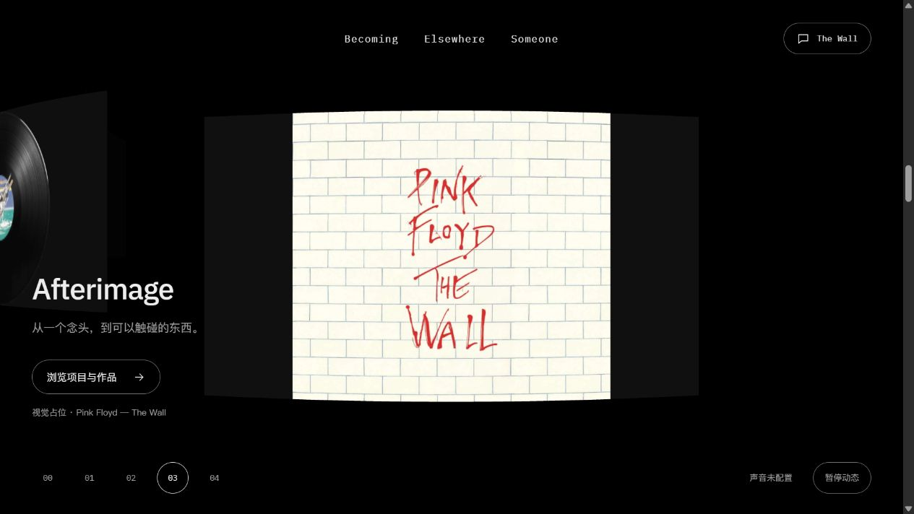
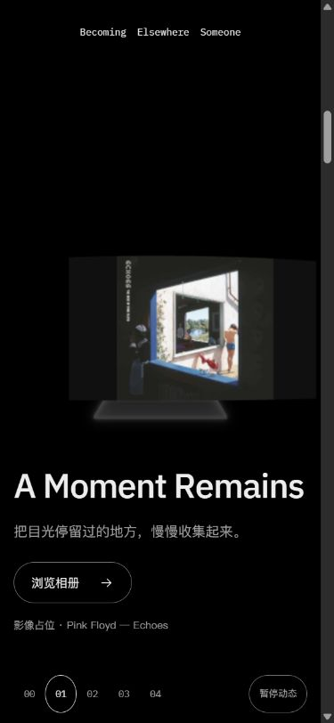

# 首页三卡顺序调整：执行者交付

2026-10-14 · P01/P14 · R01/R12 · U03/U05/U07 · T03.02/T03.03/T03.04。**本机实现与执行者核对完成，候选冻结，待独立设计/用户体验。**本轮只调整当前人类指令，F03加载页以此最新基线随后接续，没有混入本片。

## 结果与入口

[4342体验入口](http://127.0.0.1:4342/personal-homepage/#album)。刷新后第一张为A Moment Remains，依次Echoes、Afterimage，再到The Wall。旋转区Elsewhere移除；用户措辞为“首页旋转页”，本批按旋转区处理，顶栏Elsewhere仍去真实常用网站页面。

实际 `HomeJourney.Buuw_zpt.js`，1,172,722 bytes，SHA256 `61BE46FD1E48E8C46906AA36D2C901D7F165538BC3E8C9D9FDF734CF058AA58D`。23源哈希及7个实现/测试变更清单见[frozen-candidate.json](frozen-candidate.json)；原B46清单中4变化、16保持，另外3个改动文件本轮补录哈希。未提交或部署。

| 序号 | 稳定ID / 标题 | 实际入口 | 画面 |
| --- | --- | --- | --- |
| 01 | album / A Moment Remains | /gallery/ | Echoes影像占位 |
| 02 | radio / Echoes | /music/ | Wish You Were Here唱片占位 |
| 03 | projects / Afterimage | /showcase/ | The Wall项目占位 |
| 04 | wall / The Wall | /guestbook/ | 原向上垒墙 |

章节数据同源派生DOM、GL媒体映射、卡数、导航与滚动提示；删除LinksWorkCard及其CanvasTexture绘制/字体回调。卡数3，原始稳定ID和CTA路由保留；旧已删除章节的返回快照回到序章，不使用旧绝对y误落转场。F02上垒/底边裁剪/材质/柔光源码保持。

## 区间与验证

数值唯一依据[SYSTEM9.2.5](../../../../SYSTEM.md#925-全屏扩展与叠层接续)。n=3，每卡1H，prepare5.5H+100→6.5H+100，expand仍3H，wall尾段仍2H：

| 节点 | 桌面H720 | 窄屏H844 |
| --- | ---: | ---: |
| prepare起点 | 4060 | 4742 |
| expand起点 | 4780 | 5586 |
| expand完成 | 6940 | 8118 |
| 阅读完成 | 8380 | 9806 |

- `tests.log`11/11，现有区间测试更新为三卡，砌墙/覆盖/可逆等测试保留；没有为数据排序另建镜像测试。
- `check.log`108文件零诊断；`build.log`15页/Pagefind成功，原404/chunk提示保留。Impeccable单次限定扫描`detector.json=[]`；限定diff空白检查通过，LF/CRLF提示保留。
- `browser-samples.json`9份实际DOM状态：桌面与390×844三张卡index约1/2/3、章节01/02/03、无第4卡；完成墙面index4、导航04、阅读门禁与99/138砖正常。相册入口真实到/gallery/后浏览器返回，恢复album/index1，截图另有`gallery-entry.*`。
- 没有量化帧率/真机/系统减少动画/BFCache及全套连续F02重测；静态/quiet的数据顺序使用同一DOM，未强制模拟OS偏好。

## 原图优先级与采集限制

原生`getScreenshot`的初批画面有一帧延迟，不能把标签与随后读取的DOM当成同一帧：例如`desktop-projects.png`实际是Echoes前帧，`mobile-album.png`实际仍是缩放后的桌面构图。9份原图全部保留，初批DOM能说明数据/index，不能单独证明对应截图的稳定美术。

定向确认改为Tab直接页面截图：

- `confirmed-desktop-projects.*`实际1280×720，Afterimage/The Wall封面，章节03，右侧没有Elsewhere卡。
- `confirmed-mobile-album.*`名称来自窄屏尝试，**实际1280×720**：新建标签恢复默认尺寸，JSON实际尺寸为准；该图仅证明桌面首卡，不能当作手机证据。
- `actual-mobile-album.*`新建标签后再设置覆盖并读回390×844，实际A Moment Remains/影像、章节01、标题与按钮无横溢出。此图是本批首卡窄屏的权威画面。

桌面/窄屏两次等候wall-ready超时，但随后真实DOM均到达阅读态，无运行error；保留为工具等待失败，不写整批无异常。首次相册按钮在入场门禁尚未开启时过早点击，没有跳转；读回门禁后按可访问名称点击，实际/gallery/及返回成功。源码裁剪命令的本机Python别名不可运行，改用原生PowerShell完成；类型/构建没有由此发生错误。

控制台原始结果见`console.json`、`confirmation-console.json`、`actual-mobile-console.json`；保留警告。所有临时标签已关闭，视口已复位。当前不追加美术循环，独立设计复核或新的人类指令优先；F03采用本三卡基线，不恢复旧四卡。
