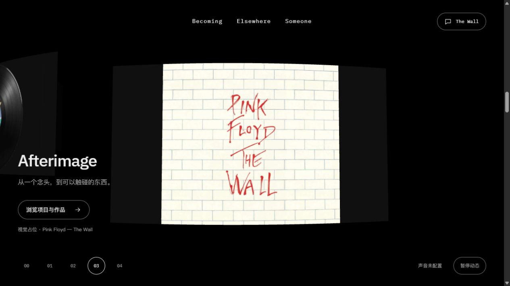
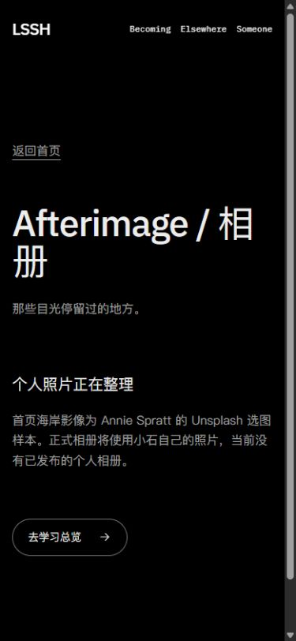

# 三卡候选的限定独立检查

2026-10-14，设计对话实际浏览器检查。**只对应已加载的 Buuw_zpt 三卡画面；期间出现用户最新“单个砖块稍微有点大”反馈，首页开发正在调整砖块。因此本记录不能作为后续新砖尺寸候选的通过结论，也不称当前全部源码冻结通过。**

## 实际范围与证据

- URL：`http://127.0.0.1:4342/personal-homepage/?opticsDebug=1#album`。浏览器实际组件为 `/personal-homepage/_astro/HomeJourney.Buuw_zpt.js`；首页所有已采样状态均读回该组件名。
- 初次命令读回冻结清单23源、0漂移；交付声称的包为1,172,722 bytes、SHA256 `61BE46FD1E48E8C46906AA36D2C901D7F165538BC3E8C9D9FDF734CF058AA58D`。这是工程清单声明，**本次未另取得实际HTTP响应体哈希**：shell访问localhost套接字被沙箱拒绝，不将失败/null写为包不匹配。
- 结束时再次核对，wall-assembly、RisingWall、wall-material、区间测试4文件已改变，原包在dist中已不可取。开发状态与人类消息确认其正在响应砖块尺寸新要求，旧原图保留，不重复追着变化中的构建验收。见 `candidate-verification.json`。
- `browser-samples.json` 与10份同名PNG为本次独立原图/状态。直接Tab截图，状态取样与截图相邻但非GPU原子帧；不宣称逐帧时长或帧率。桌面1280×720、窄屏390×844，实际内容宽度分别1265/375；末次窄屏scrollWidth=clientWidth=375，无横向溢出。

## 已观察到的行为

| 项目 | 实际结果 |
| --- | --- |
| 三卡顺序与入口 | 桌面01 A Moment Remains / gallery，02 Echoes / music，03 Afterimage / showcase；图片对应Echoes影像、Wish唱片、The Wall。旋转区没有第四张Elsewhere卡，04为留言墙 |
| 末卡到墙 | 真实向下滚动从projects 2980到prepare 4726、砌墙中段6076、完成8524；中段10砖，完成99砖，四角覆盖、阅读文字和导航可见 |
| 反向 | 从8524向上滚回6076，仍为同一10砖/同一窗口形态；仅限此定向回退，不冒称本轮完整F02矩阵重测 |
| 窄屏 | 首位相册在1788/index1，标题/按钮可读；墙9806/index4，138砖完整覆盖，未发现横向溢出 |
| 相册返回 | 浏览相册实际到/gallery/，浏览器后退恢复1788/index1、焦点entry-album；同一三卡位置恢复 |
| 运行日志 | 当前临时标签日志0 error、4 warn，原始见console.json；不是全站所有页面无错误的结论 |

## 新发现：目标页未同步

4342的 `/gallery/` 仍显示“Afterimage / 相册”、旧占位文案“个人照片正在整理”，不是首页名称“A Moment Remains”。实际截图 `mobile-gallery-destination.png`。路由可达和返回可用，但不能将其称为新相册已整合。

应由首页开发在当前砖块反馈收束后核对预览产物与独立相册的最新交付来源，确认整合归属和真实入口；设计不改独立相册实现、不自行覆盖其他任务文件。该问题不改变三卡排序已显示的事实。

## 限制与下一步

没有重测快滚中断、暂停、系统减少动画、实体手机、BFCache、全部刷新和连续截图时序；F02此前证据仍保留但不套用于最新砖尺寸。手机通过章节链接到墙，不称手机全段自然滚动已重新验证。普通页旧字标/相册占位属于整合问题，不混入F03美术通过。

临时标签18已关闭，viewport覆盖已reset。首页开发正处理用户更晚砖块尺寸反馈，暂不发送打断性实现要求；F03保留授权并等待最新候选固定，下一次集中跟进时一并给出上述整合问题。当前不追加美术循环，不标用户通过。

