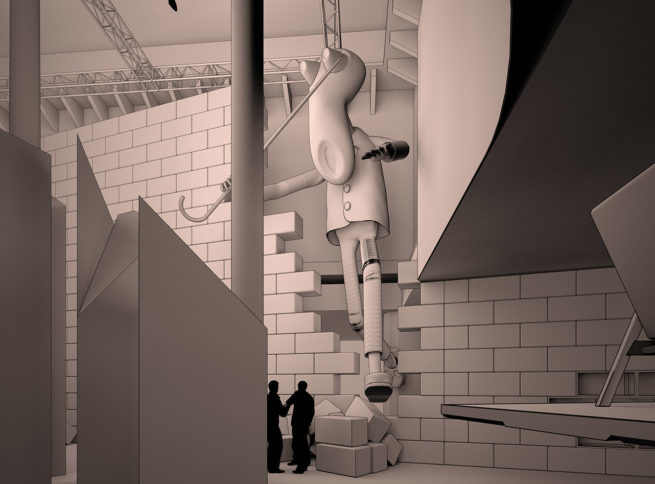

# U02 墙体风格参考与用户反馈

- 日期：2026-10-07；执行者：Codex。
- 页面：P01 首页、P14 留言墙；概念：C01 同一处空间、C05 回应使边界可读、C07 温柔来自可控。
- 状态：**方向已获用户选择；样本待制作、视觉与运行待验证。**
- 本轮目标：把用户选中的墙面观感写成可施工、可验证的基准。

## 用户反馈与原图

用户原话：“墙的材质应该是这种风格比较好”。

图片为本轮用户附件，655×484 PNG，290,710 字节；从临时附件原样复制，无裁切和调色。原作者与原图 URL 尚未核对，只作为设计参考，未接入网页或发布。本次偏好指墙面风格，不能扩展为用户已选择图中人物、装置、断墙和坍塌场景。

## 观察与决定

图中墙体以较大的横向矩形块规整错缝，正面平整、纹理很弱，接缝细，体积由块体侧面和接触阴影呈现。整体暖灰观感用作照明参考；截图不能确定原物的制作材料和真实尺寸。

以上为执行者对用户选图的解读。正式外观基线只维护在 [SYSTEM 7.2](../SYSTEM.md#72-墙面的已选视觉方向)，候选状态只维护在 [REFERENCES](../REFERENCES.md)。同一墙体随距离与受光显现，空间规则见 [CONCEPT](../CONCEPT.md#51-场景模型)。

- 保留：用户选定的平整哑光块体方向；原先黑色远景到白色阅读面的关系。
- 调整：先试成熟标准材质与基础几何，按需要比较 PaintedBricks004 的弱表面细节。
- 降级：Whitewashed Brick 的掉漆、风化和露砖效果不再是首轮候选。
- 尚未发生：材质文件接入、静态网页样本、受光对比、动画与留言功能验证。

## 下一轮简报

唯一主要变量为表面细节强度。固定砖块排列、相机、灯光和代表性留言，先看低纹理样本是否已经成立；不以增加噪声作为默认精细化手段。

按 PLAN 既有视口检查暗端轮廓、亮端块体与接缝、手机阅读和文字干扰；再决定是否需要贴图。参数记录在 SYSTEM 或对应样本记录中，后续几何运动与受光仍分轮验证。

## 本轮证据

- 已直接查看用户原图；已原样归档并检查文件一致性。
- 已检查实际首页源码，目前仍为文字入口，没有可直接替换的墙体实现。
- 用户选择与执行者解读已分别记录；没有用文档更新代替视觉验收。
