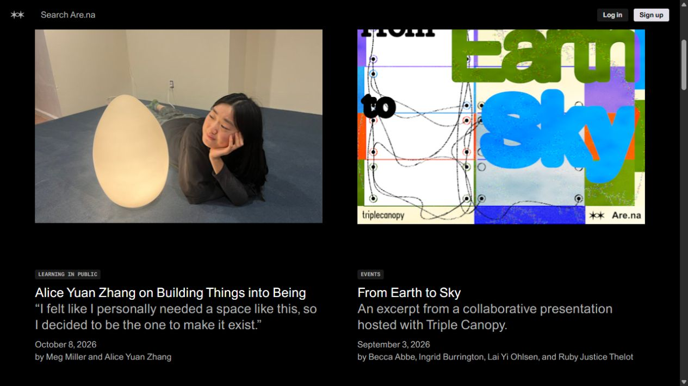
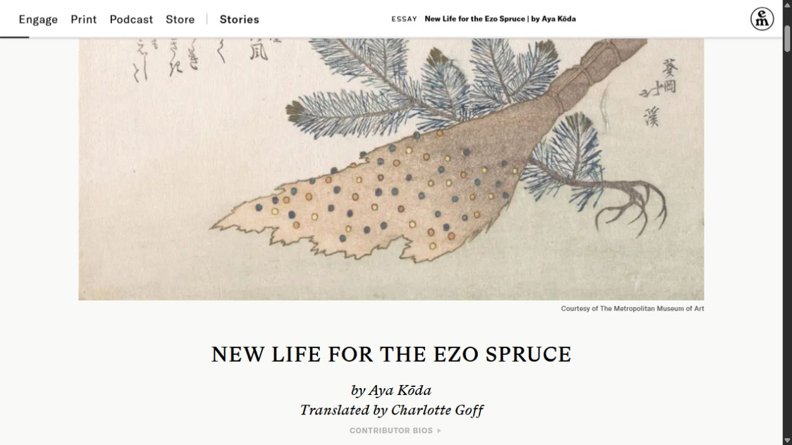
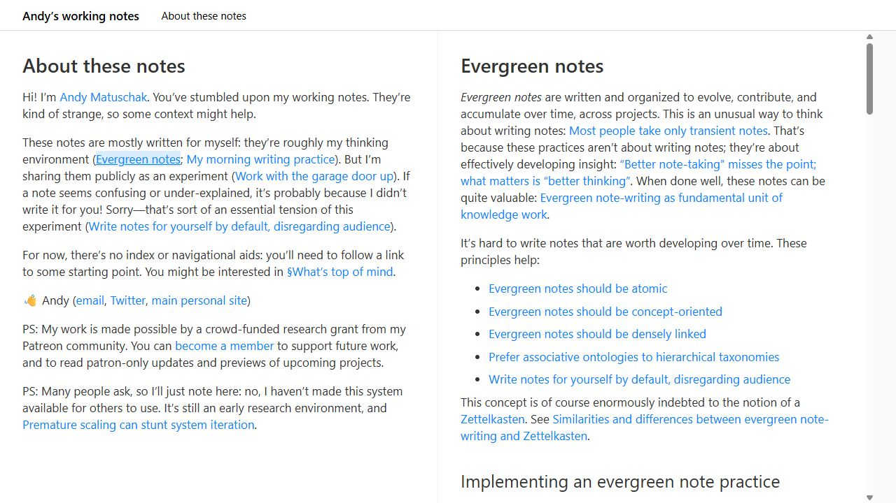

# Becoming 博客第二轮：浏览构图与阅读方式候选

2026-10-14。用户反馈第一轮案例在视觉个性、布局与阅读体验、与个人主页的艺术氛围三方面都不满意，上一轮主设计推荐已撤回。**这一轮把选择拆成三种明确的体验：黑色创作档案、情境长文、对照研究笔记。** 前两项用于判断整体视觉与内容节奏，第三项用于判断学习时的阅读方式；它们尚未成为本站实现方案。

归属 P03/P06/P15、R02/R09/R10/R12、U09/U13/U14、T05/T07/T09/T10/T26/T27。参考[已有概念](../CONCEPT.md)、[字体与设计参数](../SYSTEM.md)、[页面关系](../SPEC.md)及[文档对应表](../../README.md)。主工作区有其他栏目进行中的变更，本轮只处理自己的研究文档与证据，不修改应用源码。

## A. 黑色创作档案

参考 [Are.na Editorial](https://www.are.na/editorial)。本机实际页面以黑底、开放的双列内容图片、直接排在图片下的标题与摘要建立层级，图像拥有足够的观看空间。进入文章后，来源与关联线索在桌面正文旁出现；从文章返回列表，原来浏览的条目仍在视口中。

**对 Becoming 的构想：**总览先呈现作者正在关注的主题和少量精选内容，再提供可快速扫读的全部条目。资料可以使用真实封面，文章可以使用文中已有图像，笔记保持文字入口；三类内容拥有各自合适的呈现方式，同时共用科目、搜索与筛选。黑色留白连接首页的空间感，内容本身承担个性。

**阅读方式：**文章正文作为主区，来源、关联资料和返回路径成为较轻的辅助区。实际参考站手机把来源区放在标题之前，桌面文章还出现横向滚动条；这两点需要本站样本重新验证，不直接采用其全部布局。本站的中文标题、字体回退和手机首屏顺序仍按现有规范检查。

**材料需求：**代表性资料的真实封面或可公开的 PDF 首页面、已有文章配图、真实主题与摘要。封面不是所有内容的必填条件，也不生成与文章无关的装饰图片。

## B. 情境长文

参考 [Emergence 的文章开篇](https://emergencemagazine.org/essay/new-life-for-the-ezo-spruce/)。实际页面先给出完整图像，再用标题、作者与引言引入正文；滚动后，顶栏保留当前文章身份。图像开篇和正文之间有明确节奏，适合值得慢读的完整叙述。

**对 Becoming 的构想：**重要原创长文可以像一个独立专题，有一幅与内容直接相关的开篇图像和简洁引言，进入正文后保持安静。个人阅读、哲学、创作过程等内容可以因此更有情境；资料与短笔记仍直接到内容。它借鉴的是构图与阅读节奏，本站黑灰和苹方保持为基线，原站浅色底与衬线字体不构成新的规范。

**阅读方式：**目录根据长文结构按需使用，文中图片、公式或例子紧跟对应解释；作者说明、来源和相关内容服从阅读顺序。实际首次访问出现自动订阅浮层，需要主动关闭，属于打断阅读的观察，不纳入本站设计。

**材料需求：**一篇已经写成的长文、与其内容有关且可以使用的图像、真实引言。没有合适图像时，排版应独立成立。此方向优先验证一篇文章，不把所有笔记都包装成专题。

## C. 对照研究笔记

参考 [Andy Matuschak 的 working notes](https://notes.andymatuschak.org/)。实测从入口点击引用，新笔记在右侧打开，原文保留在左侧；地址携带打开的笔记状态，阅读上下文仍可见。这是一种值得研究的学习操作方式，其白底蓝链接并非本站的视觉目标。

**对 Becoming 的构想：**普通阅读时，相关笔记或资料可以在旁边临时打开，用于对照定义、例子、公式或 PDF，结束后回到原文位置。它可以采用 A 的黑灰表达，也可以作为独立的可选阅读方式。手机应先保证一份内容完整可读，并明确回到上一份内容的入口。

**边界：**这会新增阅读方式，需要单独验证布局、返回、焦点和手机行为。Andy 的窄屏采集显示当前笔记及右缘部分内容，来路与退出尚未验证，不能作为成熟手机方案的证明。作者入口也说明这仍是研究环境，尚未作为可供直接使用的系统公开；这里仅参考行为，后续技术选型另做。既有 PDF 沉浸模式继续按用户要求全屏无界面元素，侧开资料属于普通阅读的候选，不进入沉浸画面。

**材料需求：**一篇真实笔记、一个真实引用、对应的公开资料或另一篇笔记；先做两份内容的对照样本，不扩展成无限列或关系图。

## 辅助案例与筛选判断

| 案例 | 本轮实际依据 | 可借鉴的部分 | 使用边界 |
| --- | --- | --- | --- |
| [Rauno 的交互设计长文](https://rauno.me/craft/interaction-design) | 桌面文章、左侧目录及章节定位实际画面 | 稳定阅读区域，正文与媒体示例结合，动作和解释相邻 | 原站目录较长、媒体较多；不把全部动效引入本站 |
| [Maxime Heckel 的视觉技术长文](https://blog.maximeheckel.com/posts/on-rendering-the-sky-sunsets-and-planets/) | 桌面文章与原生导航；正文、图像与图形控件结构 | 技术学习内容可以通过图解和小型可体验例子讲清楚 | 本轮未运行全部图形例子；Index 实测返回首页，不能误写为文章目录；不采用 Ask 或 AI 功能 |

Are.na、Emergence、Andy 分别是内容社区的编辑栏目、杂志长文和作者的公开研究笔记，这轮比较的是具体的内容设计与阅读模式，不把它们当成可直接安装的博客主题。The Creative Independent、Dan Mall 仅做官方结构初筛，Robin Rendle 的网页读取被 robots 限制，均未作为本轮实际体验主样本。

## 下一步如何小步验证

| 候选 | 下一片的唯一目标 | 用户可以判断的结果 |
| --- | --- | --- |
| 选择 A | 一页 Becoming 总览构图样本 | 身份、主题与精选内容是否吸引人；能否找到资料、文章、笔记并进入正确内容 |
| 选择 B | 一篇中文长文开篇与正文样本 | 图像与内容是否相关；开篇是否有氛围；正文是否及时、舒服地进入 |
| 选择 C | 一个原文与引用的普通阅读对照样本 | 能否查看资料而保持原文上下文；能否退出并回到原位置 |

本轮设计判断倾向于先用 A 检验 Becoming 的整体表达，再单独判断是否需要 C 的学习阅读方式；B 可留给重要原创长文。此判断不是用户选择，不同时开工三项，也不沿用第一轮“只微调排版”的实施顺序。标签浏览继续可选，P04/P07 保持停用。

## 证据与复用条件

[实际采集与操作记录](evidence/u09-blog-directions-2026-10-14/README.md)保存页面原图、来源、范围和采集偏差。Are.na 已实际检查列表进入文章、返回原列表位置及 390px 文章；Andy 已检查一次引用打开，手机完整旅程未验；Emergence 检查了浮层关闭和开篇至正文的滚动；Rauno 检查了章节定位。没有把网站自述、参考站运行或研究建议记为本站实现通过。

来源统一登记在 [REFERENCES](../REFERENCES.md#becoming-博客第二轮调研2026-10-14)，新增参考 ID 为 BLOG26-07–11。截图仅作本机研究参考，原站照片、插画、字体、正文和实现代码未接入本站，也未取得整站资产复用授权。后续真正采用的素材、组件和参数分别回到 REFERENCES、技术选型及 SYSTEM 记录。

状态：第二轮研究完成，三个候选待用户判断；应用、现有路由、设置及部署未改动，没有创建提交或 PR。尚未验证全面可访问性、实体手机、大陆访问、性能、所有交互或素材复用许可。
