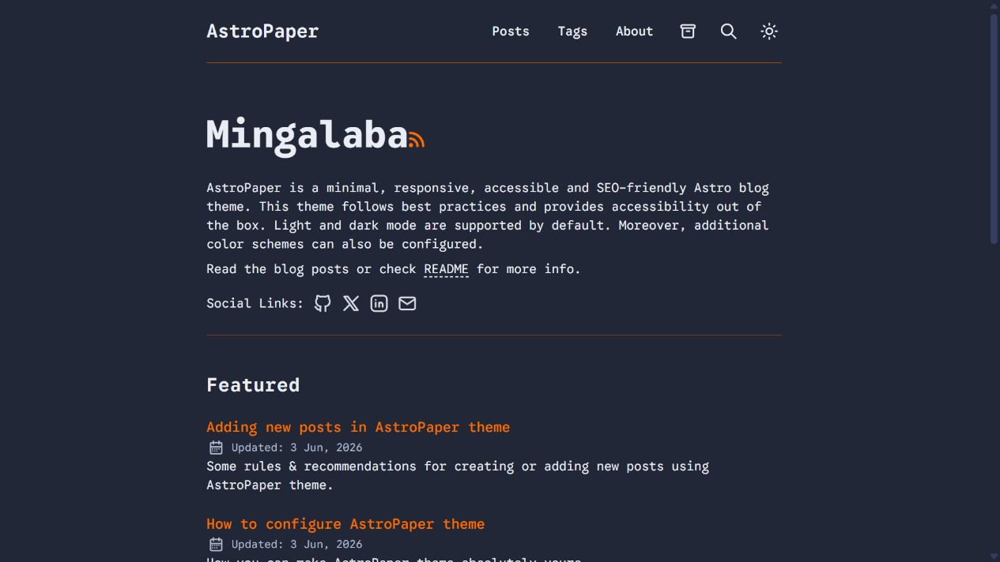
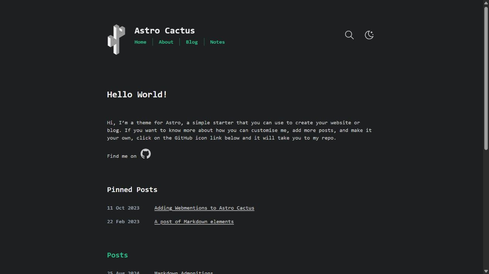
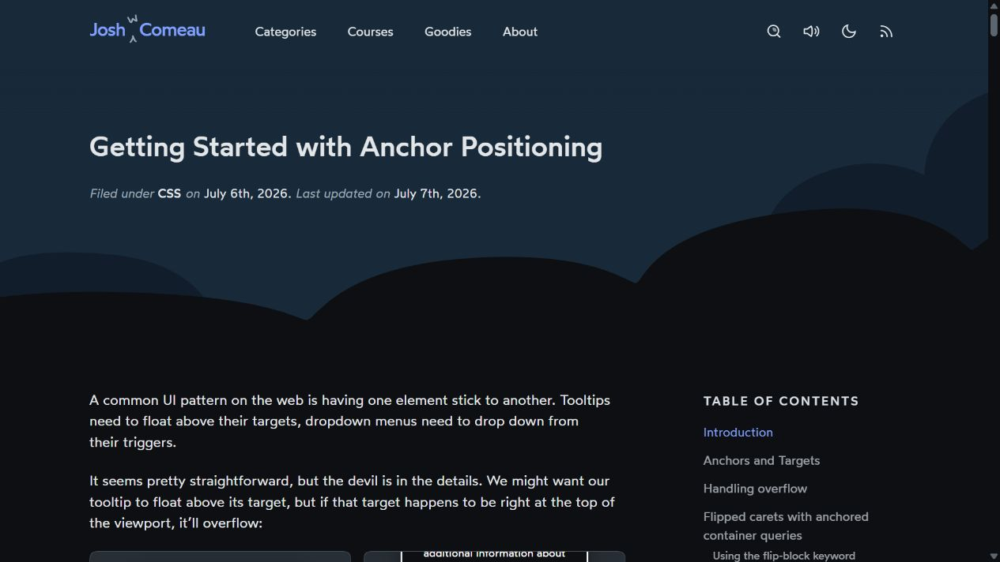
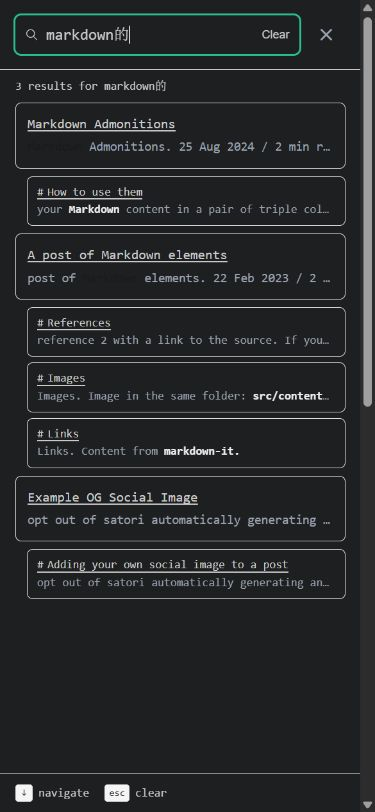
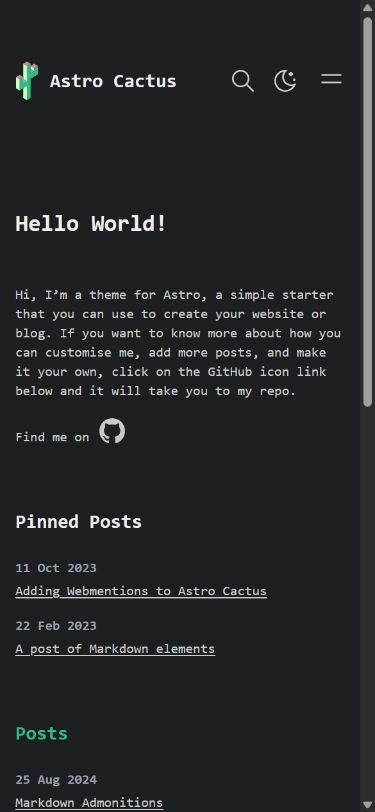
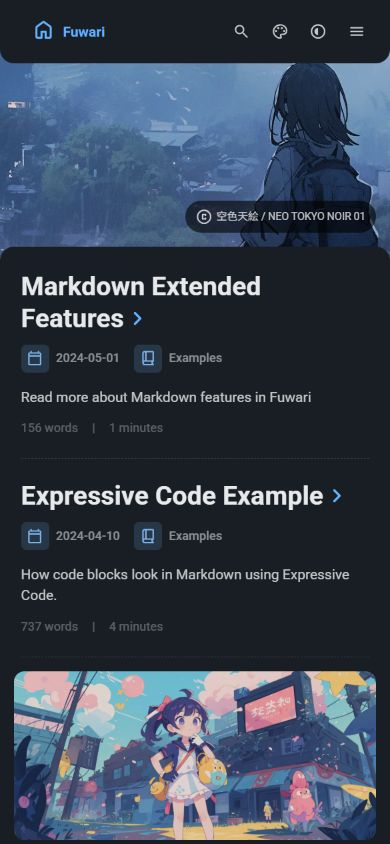

# 博客 UI/UX 项目调研与本站适配建议

**最新用户反馈（2026-10-14）：本轮案例均不满意，视觉个性、布局/阅读体验和与个人主页的艺术氛围三方面都未达到预期。下文的主设计推荐撤回，内容保留为历史研究与功能机制参考；不依照本轮推荐推进实现。下一轮重新筛选具有明确视觉方向与阅读方式的案例。**

2026-10-14。**建议以 Cactus 的紧凑索引和 AstroPaper 的摘要列表为主要结构参考，借鉴 Josh W. Comeau 的长文分节，再用 Maggie Appleton 的内容状态说明帮助读者理解笔记。** 对本站而言，先改善中文阅读和查找效率，比增加装饰或功能入口更有价值。这是调研结论，尚未作为新的实现方案或用户审美确认。

本轮覆盖 P03 学习总览、P06 博客与花园笔记、P15 搜索，关联 R02/R09/R10/R12、U09/U13/U14、T05/T07/T09/T10/T26/T27；P05 的 PDF 阅读只作为边界核对。沿用[文档对应表](../../README.md)、[页面规格](../SPEC.md)、[概念](../CONCEPT.md)与[统一规范](../SYSTEM.md)。资料、文章、笔记继续属于同一知识库；标签浏览继续可选，P04/P07 保持停用。

## 1. 样本与证据

选择覆盖文字型博客、卡片型博客、教学长文和持续更新的笔记，按信息层级、阅读、查找、跨页返回及手机适配比较。没有用星数、项目自报的性能分数或获奖标签替代体验判断。2026-10-07 已研究过 Paco、Maggie 和 Josh，本轮增加开源项目并补充实际桌面、手机画面，历史依据见[博客设计研究](../REFERENCES.md#p03-博客设计研究2026-10-07)。

| 样本 | 已核对的内容 | 最值得参考 | 本站适配判断 |
| --- | --- | --- | --- |
| [AstroPaper](https://astro-paper.pages.dev/) | 官方演示、文章与搜索页结构；桌面首屏原图；[源码](https://github.com/satnaing/astro-paper) | 标题、日期、摘要的单列层级；精选与最近文章分组；文章内可折叠目录 | 作为博客列表的主要参考；沿用苹方和黑灰，不移植等宽正文字体及橙色强调 |
| [Astro Cactus](https://astro-cactus.chriswilliams.dev/) | 桌面/390px 首屏；手机菜单展开、搜索面板及结果；文章/短笔记页面结构；[源码](https://github.com/chrismwilliams/astro-theme-cactus) | 桌面日期与标题对齐，手机上下重排；短笔记直接呈现；搜索有摘要和章节入口 | 适合归档、紧凑索引和短笔记；搜索呈现优先复用现有 Pagefind |
| [Fuwari](https://fuwari.vercel.app/) | 桌面/390px 首屏原图、Markdown 文章和归档结构；[源码](https://github.com/saicaca/fuwari) | 圆角面板的分组、标题与元信息的距离；手机首屏以文章列表为主体 | 仅局部借鉴分组与留白；大横幅、头像侧栏和彩色插画会提高学习区的视觉占用 |
| [Josh W. Comeau](https://www.joshwcomeau.com/css/anchor-positioning/) | 文章桌面/390px 原图；正文、目录与交互示例结构 | 正文与桌面目录分离；分节讲解，例子紧跟解释；示例有浏览器不支持说明 | 借鉴阅读节奏和示例降级；大面积插画过场不适合本站日常查阅 |
| [Maggie Appleton](https://maggieappleton.com/garden) | 花园及[内容可信程度说明](https://maggieappleton.com/epistemic-disclosure)的网页结构；本轮未完成筛选交互验证 | 区分内容类型、成长阶段、首次与最近更新，说明内容的完成程度 | 状态说明可作后续候选；先用现有类型与更新时间，不强制增加作者维护字段 |
| [Quartz](https://quartz.jzhao.xyz/) | 官方站与[反向引用文档](https://quartz.jzhao.xyz/plugins/backlinks)；[源码](https://github.com/jackyzha0/quartz)；本轮未验证其交互 | 把真实反向引用放在阅读上下文中；没有引用时可隐藏该区 | 用于改善已有“被引用”区的层级和空状态；不引入新生成器或恢复关系图 |

本轮保存 **8 张实际页面原图、3 份 Cactus 手机操作后的 DOM 状态**，详见[证据目录](evidence/u09-blog-uiux-research-2026-10-14/README.md)。浏览器控制前段连续超时；换用同一浏览器的已加载标签接口后完成上述截图与部分交互。AstroPaper 的文章跳转未得到浏览器确认，搜索精度、返回恢复、读屏、减少动画、真机与大陆访问质量均不在本轮通过范围。

## 2. 值得借鉴的设计机制

### 列表服务两种阅读意图

AstroPaper 的摘要帮助第一次来的读者判断文章是否值得打开；Cactus 的日期与标题适合找已经知道的文章。这两种机制可以分别服务博客列表与归档页。本站列表建议保持“标题 → 简短摘要 → 类型/主题/真实日期”的层级，归档采用紧凑行；没有封面图的文章仍应完整成立。标题自然换行，不通过裁掉中文长标题维持齐整。

### 阅读页让正文承担主要信息

Josh 的桌面长文把目录放在正文旁，手机则让正文独占横向空间。对本站，目录应帮助定位当前章节，相关内容和被引用区适合放在正文结束后。不能为了排版整齐把正文压成窄缝，或让多个固定工具条挤占手机视口。本站已有目录、关联链接、阅读模式，应优先调整它们的层级和空间，实际行为逐项回归。

中文样本直接使用 SYSTEM 第 3 节：苹方优先、手机 16px/桌面 18px、行高 1.8、正文约 36em。英文站点的等宽字体和英文字符行长不直接转换成中文参数；Windows 缺少苹方时检查实际回退字族。正文中的公式、代码、表格和 PDF 保留各自需要的排版。

### 搜索应解释为什么匹配

Cactus 实际搜索面板提供结果数、标题、匹配片段和可直达的章节。本站可先核对现有 Pagefind 是否已输出这些数据，再优化可见层级和目的地。搜索空结果应保留输入并给出修改方向；从结果打开文章、返回查询与阅读位置则需要专门验收，本轮没有据此判断参考项目全部通过。

### 手机端重排，减少辅助信息占用

Cactus 在窄屏把日期移到标题上方，并把主导航收进可展开菜单，搜索仍可达；Fuwari 手机首屏突出文章内容，桌面头像侧栏未出现在该首屏中。本站可让类型、主题和排序按实际宽度重排，筛选状态仍可辨认；目录按需展开，避免把桌面三栏简单缩小。正文是否溢出还要用长中文标题、长链接、宽表格和公式实测，不能只看短英文首屏。

### 笔记说明帮助读者建立预期

Maggie 把文章、笔记和不同成长阶段放在同一花园，并说明内容的可信程度；Quartz 的反向引用让读者知道有哪些内容提到当前页。本站已有文章/笔记类型与真实关联，可以先清楚呈现这些事实。如果以后需要“随记/持续整理/完整文章”状态，应先验证作者是否愿意维护，再决定字段；不根据文章长度自动判断完成程度。

## 3. 建议的最小开发顺序

下列是设计候选顺序，**未开工、未新增 T 编号**。每片只选择一个主要变量，保留现有功能，提供同一篇内容的前后对照后交用户验收。

| 顺序 | 页面及现有任务归属 | 单轮目标 | 验收证据 |
| --- | --- | --- | --- |
| 1 | P06 / U09 / T09，U14/T26 | 一篇代表性中文长文的标题、正文和章节间距；先固定目录及交互 | 桌面/390px 同文对照；中文、英文、加粗、公式、代码、表格均可读；普通阅读与沉浸分别检查 |
| 2 | P06 / U09 / T05，U14/T26 | 博客列表的标题、摘要与元信息层级 | 有/无封面、长标题和缺少日期的真实条目；分页与标签开关保持原有结果 |
| 3 | P03/P06 / U09/U14 / T07/T09/T26 | 列表或筛选结果进入文章后的返回路径 | 类型、主题、排序、分页、查询与滚动恢复；直接访问文章也有有效上级入口 |
| 4 | P15 / U13/U09 / T10/T26 | Pagefind 结果的标题、匹配片段与章节入口 | 正常结果、空结果、中文输入、Esc 关闭及焦点恢复；文章/资料/笔记目标准确 |
| 后续可选 | P06 / U09 / T05/T09 | 笔记完成程度说明与关联区精简 | 只显示真实字段和引用；无引用时不出现空面板；不恢复 P07 |

第一片的真实样本应同时包含中文段落、代码/公式和一处宽表格，不新增演示文章充当全部内容。已有类型筛选、标签浏览设置、引用、反向引用、分页和 PDF 沉浸不作为“待新增功能”重新开发。用户要求的 PDF 全屏、无界面元素、数字键模式与退出方式保持独立边界，本轮不改动。

## 4. 验收规则与适用范围

视觉验收检查层级与内容可读性，行为验收检查目的地与状态恢复，两者分开。桌面/390px 是设计样本；正式实现还需检查 320 CSS px 与放大后的重排，正文不能要求逐行横向来回滚动，必要的表格或代码区域可单独处理。[W3C Reflow 说明](https://www.w3.org/WAI/WCAG22/Understanding/reflow.html)

主操作触达沿用 SYSTEM 的 44px 项目基线，保留可见焦点、语义名称和普通键盘入口；不把“参考项目宣称可访问”当作本站已通过。WCAG 2.2 AA 的目标尺寸最低要求及例外与项目 44px 基线分开理解。[W3C Target Size (Minimum) 说明](https://www.w3.org/WAI/WCAG22/Understanding/target-size-minimum.html)

从参考项目得出的布局好坏及本站优先级属于本轮设计判断；截图与官方文档只证明相应画面、结构或声明存在。尚未开展用户测试或完成全面可访问性审核。

## 5. 复用与许可

来源登记在 [REFERENCES 的本轮条目](../REFERENCES.md#博客-uiux-补充调研2026-10-14)。AstroPaper、Cactus、Fuwari 和 Quartz 官方仓库标注 MIT，可作为未来代码复用候选；真正移植前仍要检查所用文件、保留许可并验证与现有 Astro/Starlight 的兼容性。MIT 代码许可不自动覆盖演示插画、照片、字体或第三方内容。Josh 与 Maggie 本轮只作设计参考，没有下载或复制其站点资产、正文与实现代码。

沿用现有 Astro/Starlight、starlight-blog 与 Pagefind；不引入第二套完整主题、路由或生成器。Awwwards 的[博客案例目录](https://www.awwwards.com/websites/blogs/)已按用户的资源提醒要求提示，用于发现视觉参考；本轮样本没有因此被称为获奖项目。没有生成新素材，也没有采用新的配色、字体或动效。

本轮产物为本地研究报告和证据，应用源码、配置与部署未改动；没有创建提交或 PR。调研完成，参考方向与开发顺序待选，实际接入及用户审美确认分别记录。
