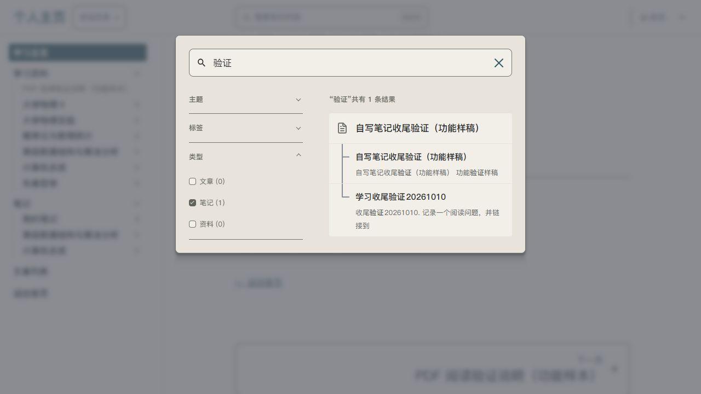
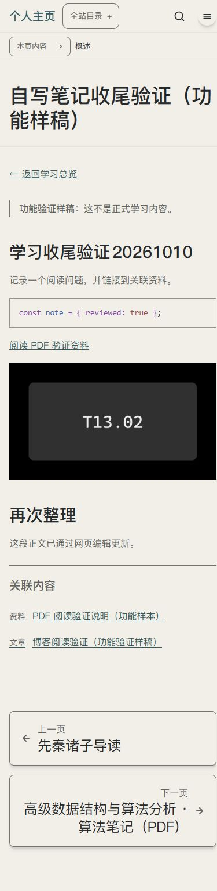

# U09 / U13 / U14 学习区收尾实例

页面P03/P05/P06/P15/P17，对应T13.14/T13.15局部/T10.01/T26.02。采用ui-ux-pro-max的可见标签、必填/草稿状态、实际目标与返回核查；沿用SYSTEM字体/控件、原生Pages CMS与Pagefind，不另设主题。新增设计资源0，已有T13.02自制插图复用。

“我的笔记”新建、正文Editor/Source、选择图片/alt、显式关联和草稿实际保存通过；“收藏笔记”目录排除writing避免重复入口。原生搜索筛选以中文类型、主题、标签显示；选笔记与阅读主题为1条，阅读返回两项/词和条目焦点恢复。关闭博客标签后正文和类型/主题保留。原布局下桌面搜索与390px正文/插图/目录、PDF侧栏收起读图通过。

PDF页码初轮自动fill未实际滚动，真实键入3页后侧栏收起保持3页，原始自动化失败与最终读图分别记录。Save重开仍可点、离开可能丢输入、自动候选回写未授权，均不记为完善状态。用户体验、读屏、真机、正式部署仍待反馈/验证。[工程证据](../../technical/iterations/learning-wrapup-2026-10-12.md)。
