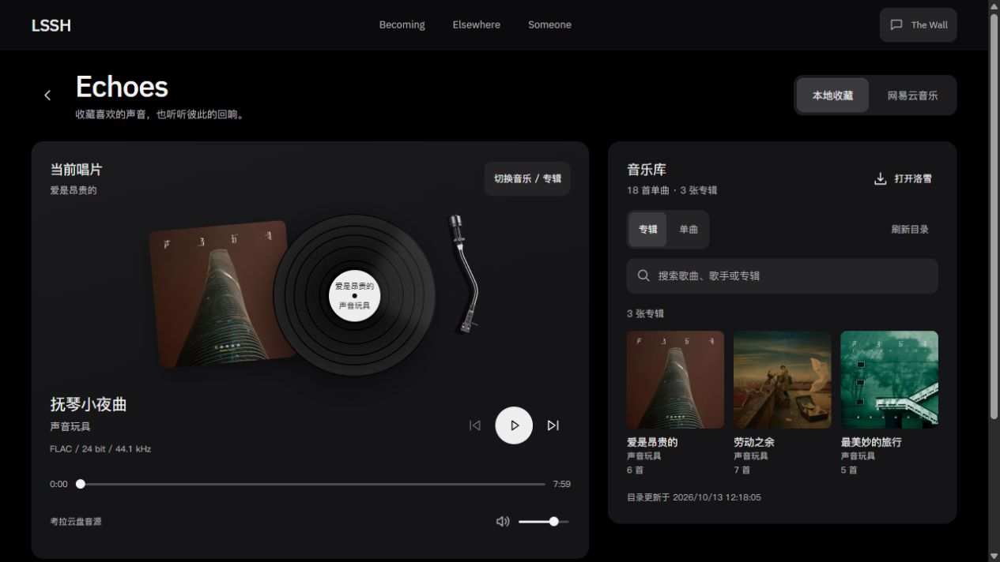

# P13 苹果界面参考精修

- P13 / U12 / R04、R12 / T25.06；2026-10-13。
- 用户新要求：根据苹果UI调整音乐页总体布局、背景、UIUX与质感。
- 本片目标：统一音乐页外壳、信息层级、局部材质与控件状态，保留本地Vinyl Vue、网易云CompScout/Glass结构和CD盒选择语义。
- 范围：音乐页面及其组件/样式；不修改首页、音源接口、授权或同步工具。
- 主阅读路径：紧凑页头与模式→当前唱片和播放控制→资料库搜索/视图→下载与音源辅助操作。宽屏播放/资料库并列，手机按相同DOM顺序纵排。
- 依据：现有CONCEPT/SYSTEM与Apple HIG布局/材质指南；沿用黑灰、苹方优先正文和IBM Plex Sans字标，不分发Apple字体/图标或引入新框架。
- Impeccable上下文实际读取成功，缺少PRODUCT/DESIGN按TOOLKIT3.1映射到已有项目文档；独立只读布局评估已完成。按技能上限进行一批桌面/手机检查、一次集中修正与确认，执行者验证不代表用户审美确认。
- 当前状态：本地实现与执行者验证完成，用户审美与手机真机尚未确认。未提交、推送或部署。

## 交付与实际检查

独立生产入口：[新版音乐页](http://127.0.0.1:4346/personal-homepage/music/?mode=cloud)。4345旧版保留用于对照。新增`music-shell.css`承担P13外壳；现有播放器的媒体逻辑保留，补原生下载details、网易云真实曲目列表与原生range的数值填充。未新增依赖、Apple字体或图标资产；导航仅以音乐页作用域适配，不修改首页源码。

- 最终类型检查60文件零错误/警告/提示；生产构建15页、Pagefind通过。仍有大分块与既有404路由提示，未记为零构建警告。
- Impeccable独立只读布局评估后完成一批桌面/手机检查，一次集中修正，再一批确认；最终机械检测为[]，结果见[检测文件](evidence/u12-p13-2026-10-13-apple-refinement/detector-final.json)。未扩展后续精修循环。
- 1280×720最终播放面板下缘716.047px，进度/音量下缘644.047/692.047px，完整操作进入首屏；音乐库三列同屏，面板下缘670.953px。录屏/真机性能未测。
- 390×844：页面内容宽375px（含原生滚动条），播放面板下缘831.094px、进度/音量下缘767.094/815.094px，实际读图通过。网易云顶部选择与原站入口合为一行，外链44×44px；实际可见按钮无小于44px项。320px内容宽305px，无横向溢出；临时viewport已重置。
- 专辑/单曲切换、搜索“超级巨星”返回1项、无结果说明/清空恢复、下载details展开及真实Scheme href通过。未自动触发洛雪外部应用；空目录展开处理按源码核对，未替换真实目录做空目录实测。
- 考拉实际播放中进入/关闭CD层：时间40.006694→40.302896秒，paused=false/error=null，取消后dialog=0、焦点回入口。网易云新增曲目行实际启动Echoes，readyState=4、time39.441244秒、error=null，另一模式音频暂停且readyState=0；最后测试音频全部暂停。
- 原生浏览器没有应用错误；Drei/Three仍输出THREE.Clock弃用警告。中间Playwright的body快捷键不受当前后端支持，改原生键盘/模式入口定位后完成；不算应用故障或假写为初批全绿。

首批问题留证：短桌面视口播放器面板下缘861.188px、播放按钮下缘739.750px，进度落出首屏；网易云单专辑使右侧缺少任务内容。集中改为按视口高度限制器物、音源/音量同排、目录三列与有界滚动，网易云旁列真实曲目、手机原站入口改44px语义图标。预览第一次受到Astro同工程单实例锁限制；未替换用户在看的4345，改只服务私有构建目录的4346本机静态工具，实际页面核验通过。

原始DOM读数：[浏览器证据](evidence/u12-p13-2026-10-13-apple-refinement/browser-checks.json)。后续仅等待用户视觉反馈；真机、系统减少透明偏好与完整跨页持续播放仍按原队列独立验收，不把本片记为这些功能通过。
