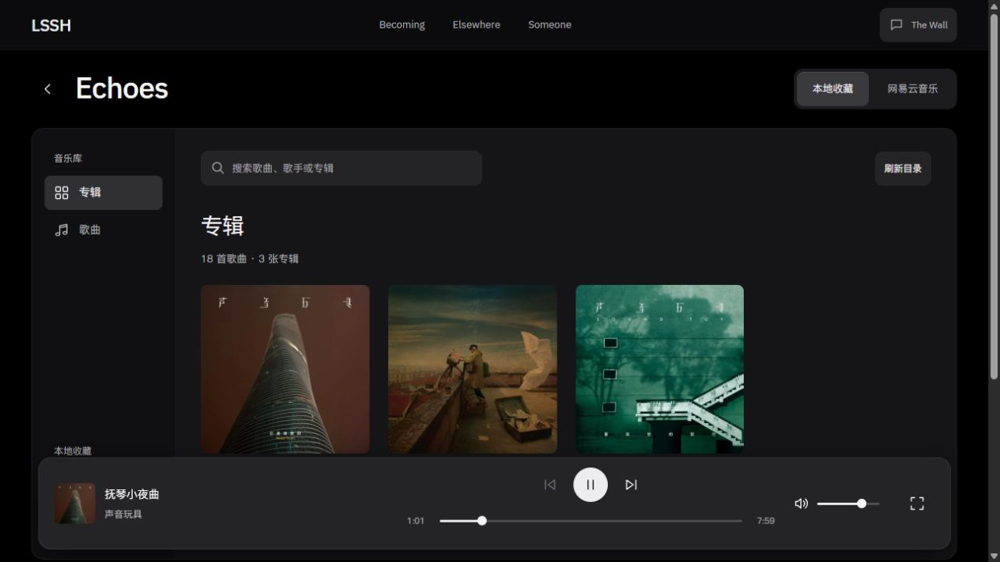
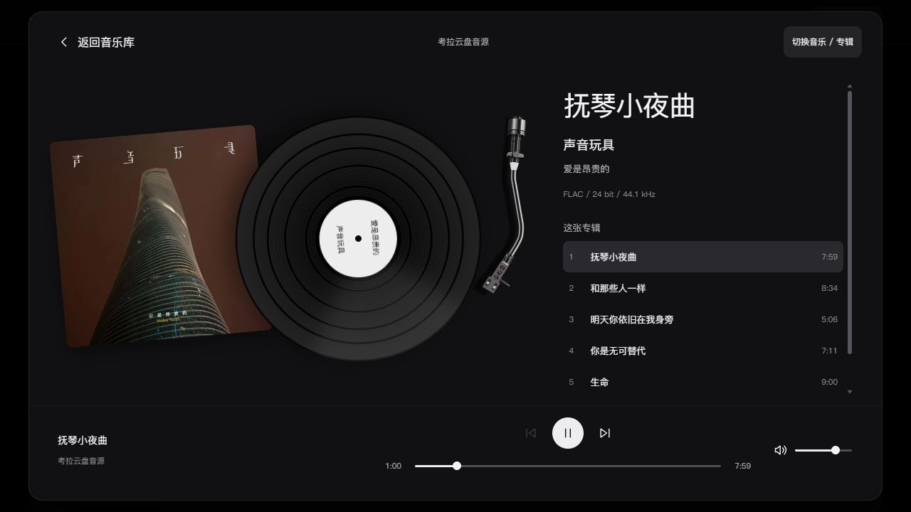

# P13 曲库与独立黑胶播放页

- P13 / U12 / R04、R12 / T25.07；2026-10-13。
- 用户决定：Apple Music曲库布局 + 网易云黑胶播放页，黑灰简约，保留现有专辑/唱片机。
- 唯一主要变量：曲库与播放状态的页面组织；音源、同步、专辑盒几何、唱片机素材与媒体进度规则保留。
- 来源：REFERENCES P13-RADIO-LAYOUT-04/05。复用现有React组件、原生dialog、真实曲目和封面，无新增依赖。官方截图仅作层级参考，不复制素材、字体或品牌。
- 曲库：左侧分类、搜索、封面网格、专辑详情/曲目表；常驻小播放条主动展开到黑胶页。黑胶页保留唱片机/封套，右侧实际专辑曲目，CD切换入口继续可用。
- 验收：两音源、专辑/歌曲/搜索和空结果、展开/返回进度连续、CD浏览取消、Esc/焦点、1280级桌面/390px/320px、类型检查与生产构建。
- 当前：本地实现/执行者验证完成；未提交/部署，用户审美与真机另验。

## 交付与复现

[独立生产预览](http://127.0.0.1:61173/personal-homepage/music/?mode=cloud)，网易云模式使用同页音源切换。开发4344亦读取新源码；原4345/4346预览未替换。4347首次启动端口已占用，未停止其他服务，改用系统分配的空闲回环端口61173。预览源与产物在被忽略的`.local-tools/music/`，只在本机提供静态文件。

页面入口改为`RadioLibraryExperience`，本地曲库`LocalMusicCatalog`、网易云`NetEaseMusicCatalog`共用`LibrarySidebar`、`RadioNowPlaying`和`ListeningRoom`。现有VinylTurntable几何/素材保持，VinylSleeve仅增可选查看箭头，原播放图标默认行为保持；AlbumSwitcher/CD场景不修改。无新依赖、下载/授权或上传动作。官方Apple/网易云图像不进入应用。

两模式只消费正在另一音乐对话接入的全站audioSession/useAudioSession，不自建audio；旧RadioExperience/NetEaseLibrary本轮保留，避免覆盖同仓库的媒体改造。用户允许发送协调信息后，已将新页面入口、推歌后续应接入NetEaseMusicCatalog的位置和原始持续播放失败证据发给“音乐电台”。后者随后补beginNavigation/finishNavigation，本预览重新构建后实际补验通过；该运行时实现属于T25.02。

复现：默认专辑网格→点封面到详情→播放专辑/歌曲→底部曲目或展开键到黑胶页→“返回音乐库”/Esc；详情“查看立体专辑”和黑胶页“切换音乐/专辑”均进入原CD盒，取消继续原曲。搜索只筛选浏览结果，不修改正在播放队列；从专辑详情播放形成专辑队列，歌曲总览使用全部可播放曲目。

## 实际证据与边界

- 音乐专用Astro检查19文件：0 errors / 0 warnings / 0 hints；最终生产构建15页、Pagefind通过。全仓早批84文件0错误/3首页提示，后续并行首页变更导致86文件中GlassTriangle.tsx两处Vector3未导入错误；音乐本轮无诊断，不改首页，也不把专用检查写成全仓全绿。构建仍有既有大分块与404路由提示。
- 真实考拉FLAC：仅一个lssh-global-audio，readyState4/error=null；展开、CD浏览取消、返回保持session和递增time。生产seek到60秒后，time60.145628→61.028451、paused=false，焦点回“展开黑胶播放器”。上下首实际更新抚琴小夜曲↔和那些人一样；专辑末曲伟大说谎者的下一首禁用，后续实际已播放到59秒且切换模式暂停。
- 本地18首/3专辑、网易云1首目录均读取真实快照；本地搜索“超级巨星”返回1项，未命中返回空结果，清空恢复。网易云曲库、详情、保留封套和黑胶展开实际读图；本轮受此前官网浏览安全拒绝约束，没有触发网易云音频/官方iframe或绕过站点限制，完整播放权限不据此提升。
- 默认桌面、390×844和320×740实际检查；390px专辑两列、底部小播放器可用，黑胶页主体独立滚动且控制留在底部；320px无横向溢出。原生dialog、Esc关闭与焦点返回通过；嵌套CD关闭先回黑胶层。减少动画沿用现有唱片/唱臂规则，本轮无新循环动画，未冒称系统减少动画或真机性能实测。
- 初批手机截屏发生视口更新未稳定，后续源码HMR重载还关闭了展开页，一项DOM记录dialog=null；原始事实保留，重新打开后按实际画面集中确认。手机播放控制初样落到内容末端，随后改为主体滚动、底部控制固定；滚动条改深灰。
- 初次普通栏目切页：原session保留但audio paused=true/time110.604178，已报告T25.02执行对话。并行修复后重新生产构建，session f7947370-6320-408a-a07f-d3e41f3562c6 在音乐→关于时time0.014134→0.557776/paused=false/error=null，返回曲库后time40秒仍播放。仅此链路补验，不替代另一对话的全站/知识库/历史完整验收。

[原始DOM记录](evidence/u12-p13-2026-10-13-library-listening/browser-checks.json)。截图含library-desktop、album-detail-desktop、listening-desktop、netease-library/listening-desktop与library/listening-mobile PNG，均为实际页面状态。未提交/推送/部署；共享工作区其他修改与用户新内容保留。

