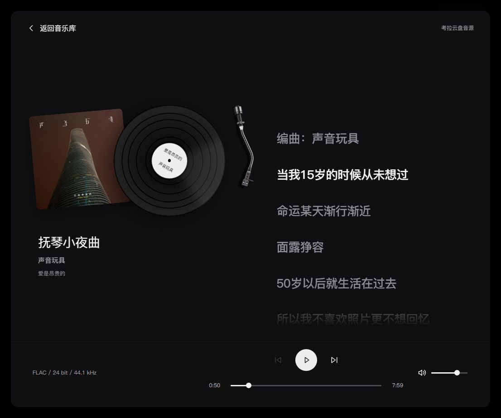
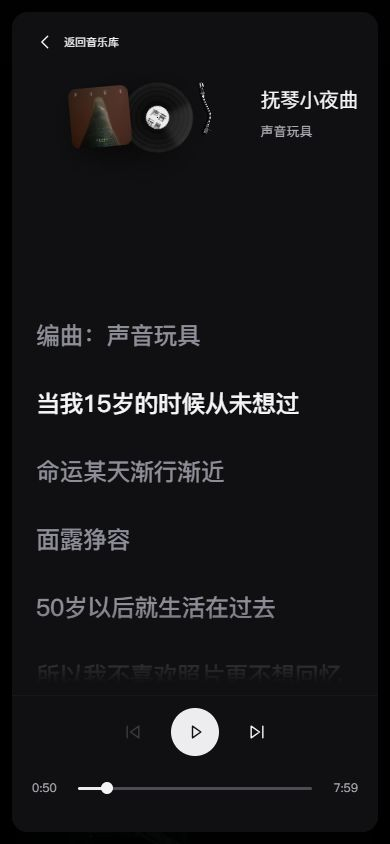

# P13 歌词与Apple原则精修

- P13 / U12 / R04、R12 / T25.08；2026-10-13。
- 用户最新三项：UI按苹果要求/感觉优化；黑胶页右侧改实时歌词；去掉选择专辑与专辑盒。覆盖T25.07的右侧列表和CD保留，不取消音乐库专辑数据/正常播放。
- 主技能Impeccable polish；context允许现有范围精修，项目上下文沿用SPEC/CONCEPT/SYSTEM/PLAN，不新建第二套规范。按一批桌面/手机检查、一次集中修正、一次确认上限交付。
- 官方Typography/Layout/Materials已实际读取，落实内容层与控制层区分、清晰字重/层级、分组与响应式；不分发Apple字体或声称原生Liquid Glass。
- 歌词优先洛雪目录18份真实同名LRC，跟随audioSession.time，点击seek、手动浏览/恢复、减少动画与缺失状态。无第二模拟时钟。
- 当前：本地实现/执行者验证完成，未提交/部署；成品审美与真机另验。

## 交付与来源

用户当前[61173预览](http://127.0.0.1:61173/personal-homepage/music/?mode=cloud)已更新。曲库保留专辑网格、详情和正常播放，所有当前CD/立体选择入口及其运行时引用撤除，music.astro不再载入album-switcher样式；生产包没有AlbumSwitcher/JewelCase分块。历史源与记录保留，不影响首页Three依赖。

本机18份同名LRC由已有索引工具读取，新增有界MusicTrack.lyrics字段；修改LRC也会触发重新索引。通过原已授权专用上传入口发布目录快照，匿名读回18首均有时间轴歌词，公开目录约194,293字符，没有本机路径或凭证。准确核对并重启原同步服务及其2个worker，以载入新解析；初次与手动同步并行产生一次“暂时不可用”，下一周期读回indexed18/verified18/pending0，原始状态保留。未改原始音频/LRC、上传权限或删除云盘文件。

网易云模式复用[LRCLIB官方匿名/CORS接口](https://lrclib.net/docs)，发送公开标题、歌手、专辑和时长；要求三项文本一致且时长误差≤2秒，避免现场版/录音室版误配。请求声明Lrclib-Client，省略凭证/Referer；12秒超时、切歌取消、128条会话缓存、429/503 Retry-After与重试状态。没有在仓库硬编码第三方歌词，也没有绕过此前网易云官网浏览限制。CLI实际读取指定Echoes录音的LRCLIB记录29725009（1618秒、synced1426字符）；本轮页面快照已由另一对话更新成11首，实际UI验证首曲Eclipse得到26行时间轴，两个来源事实分开记录。

普通LRC纯函数负责时间戳、精度、重复标记、同时间翻译合组、空行和offset；歌词高亮只读取audioSession.time，点击调用原seek。相较洛雪lrc-file-parser的完整播放计时器，本站只缺纯解析/定位与现有媒体适配，采用这一最小范围，无新增依赖。没有时间轴时显示全文，没有可用歌词时显示缺失/失败/纯音乐状态，不回填歌曲列表。

## 实际检查

- 歌词4项有意义的解析/录音匹配/字段安全测试和原云盘12项测试均通过；音乐专用Astro检查21文件，0错误/警告/提示；最终生产构建15页/Pagefind通过。既有大分块和404路由提示仍存在，不称全仓零警告。
- Impeccable一次机械检测结果[]。以用户图与当前实现为基线，首批桌面/手机集中观察，集中修正封套隐藏与缓冲按钮，随后一次确认。未开新品牌、颜色、字体或美术路线。
- 考拉FLAC真实播放：前向seek60.019095秒对应行3，反向50.008786秒对应行1；paused=false，没有第二计时器。回曲库仍同session807caafd-dd1f-42fc-ad07-59084784ada4/time50.02813、paused=false。手动PageDown显示“回到当前歌词”，恢复后控制退出；测试结束暂停。
- 当前桌面（约1113×922）实际读图，封套、唱片机、左信息/右歌词、底部控制保持。390×844歌词区508px、底部控制bottom832；320×740歌词区418px、bottom728；均无横向溢出，原生dialog返回/Esc与焦点规则保留。
- 原始首批问题：封套取消按钮后只剩AlbumArtwork span，被旧“最后一个span为悬停提示”规则设opacity0；改为静态内容容器后实际opacity1。首次视口截图缩小到旧画幅，按后续稳定帧读回；一次AX diff解析导致索引NaN，未执行定位，按实际slider71继续成功；不记为应用失败或初批全绿。
- 用户要求的“音乐列表”在右侧为0，CD控件为0。网易云实际歌词加载、缺失解析单测与版本拒配通过；本轮未再次启动网易云音频/官方iframe，完整平台播放权限另验。减少动画以源码matchMedia使用立即跟随滚动与原有停转规则核对，系统偏好/真机未实测。

[原始浏览器记录](evidence/u12-p13-2026-10-13-lyrics-polish/browser-checks.json)。UI/代码/目录改动未提交、推送或部署；用户已允许向另一“音乐电台”对话协调，已同步保留推歌/音频运行时与本轮UI修改范围。

