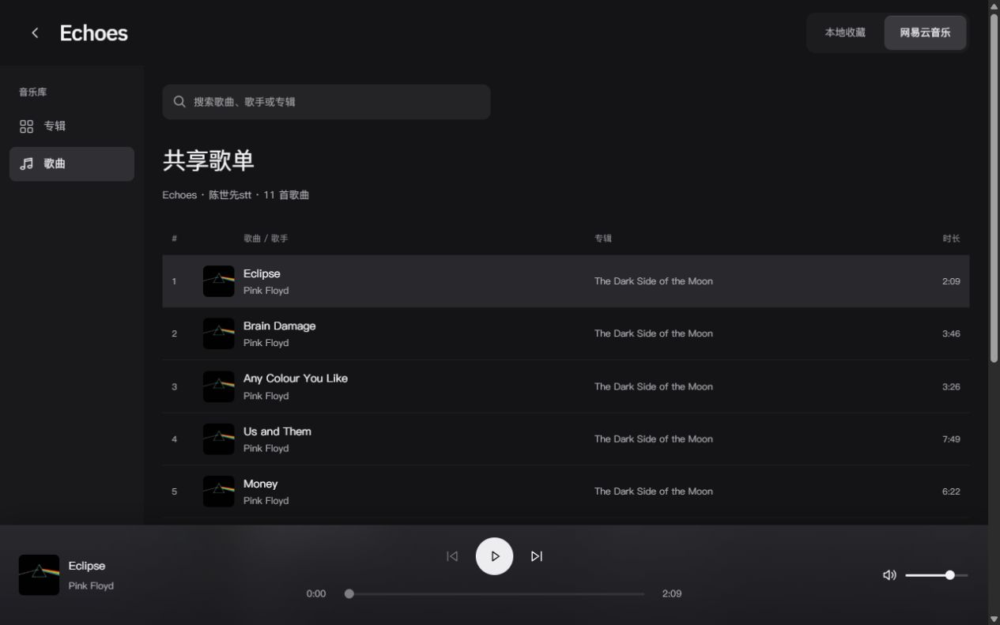
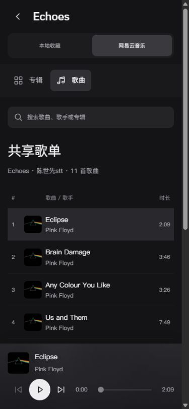

# P13 封面列表与全屏精简

- P13 / U12 / R04、R12 / T25.10；2026-10-13，用户连续补充的同一界面任务。
- 歌曲列表加封面；去外框铺满屏幕；底部播放栏改毛玻璃；整页视觉对齐；删冗余按钮，明确移除电台最上方全站导航。
- 主技能frontend-design，沿用黑灰、苹方、既有唱片/歌词/共享audioSession。重点为统一全宽栅格和内容/控制分层，不另设主题或依赖。
- 两模式歌曲/专辑详情行复用AlbumArtwork，40px/手机36px、缺图回退；保持原序号、标题、歌手、时长与点击行为。
- 电台限定隐藏全站导航/页脚；保留返回首页、音源切换、专辑/歌曲、搜索和必要播放操作。删重复展开按钮；下载/刷新/官方备用入口收进次级选项，推歌入口保留。
- 曲库和黑胶层去外框/外边距，主体铺满可用屏幕；底栏无描边半透明/blur。不支持backdrop时实色降级；本机媒体查询实际reduce=true，按用户最新明确毛玻璃选择仅覆盖该底栏的旧透明度默认规则，不更改系统设置，其他偏好保持。
- 当前本地实现/执行者验证完成；用户审美/真机另验，未提交共享工作区、推送或部署。

## 实际交付

现有[61173预览](http://127.0.0.1:61173/personal-homepage/music/?mode=netease)已更新。music-radio.css仅由P13载入并使用:has(.radio-page)限定全站导航/页脚隐藏；其他栏目及首页源码未修改。曲库去1200px外框，黑胶dialog去1440px/视口外边距。统一内容边距、对称底栏三列、标题列缩略图及其表头偏移；照片读现有coverUrl并复用AlbumArtwork，不生成或上传新媒体。

删底栏重复展开按钮，封面/曲目按钮仍打开黑胶页。网易云重复的原站链接收进音源选项，官方备用播放器仍在；推歌组件及其运行时未改。刷新按钮从搜索区移到下载说明；原自动刷新/音源权限/同步、唯一audioSession与歌词不变。

## 实际验证

- 音乐专项Astro检查21文件，0错误/警告/提示。最终生产构建15HTML与Pagefind通过；既有大分块及404路由冲突提示保留，不宣称全仓零警告。
- 1280×800：全宽主体/底栏从x0到内容可用宽1265（15px滚动条）；无边框/容器圆角。搜索与标题x208一致，行标题x312=表头列x260+52px，中央播放列中心632.5=1265/2。完整可用宽采用正常滚动条，不隐藏滚动能力凑满尺寸。
- 两源列表封面18/11，实际加载读回18/11；专辑详情行6/10分别有图，装饰性缩略图不重复朗读。搜索Money得到1行，清空恢复11行；搜索不改变媒体。
- 390×844和320×740，两模式均无横溢；36px图片、标题/表头偏移44px、内容16px一致，播放条底边等于视口高。长标题可换行，不挤掉时长/播放控制。
- 毛玻璃实际computed为blur(28px) saturate(1.4)，渐变白灰alpha .6/.75，bottom0、border0/radius0。本机reduce=true已读回，按本次明确要求只覆盖该底栏旧默认，不改OS设置；不支持backdrop时实色规则仍保留，未实测旧浏览器或真机性能。
- 真实考拉FLAC播放时黑胶层(0,0,1280,800)，手机(0,0,390,844)；无外框。实际播放17.62秒时唯一audio=1，seek到60秒后返回曲库paused=false/time60.5265；结束暂停，歌词、封面圆标/落针保留。
- 刷新目录在下载说明中1个，推荐入口1个，官方备用播放器在音源选项中1个，重复展开按钮0。原站链接未点击、未重新启动网易云平台音频/iframe、未提交推荐；本轮不重验平台许可或在线服务部署。
- 默认视口已恢复，浏览器error=[]。结束停留网易云歌曲视图；音频暂停。原始数据见[浏览器记录](evidence/u12-p13-2026-10-13-radio-simplify/browser-checks.json)。

初批保留：首次整文件补丁因命令输出附加换行核对失败，未修改应用；归一化尾部后成功。初批系统减少透明令底栏实色，按最新用户选择覆盖后，生产CSS压缩又保留末尾webkit声明而丢标准blur；调整前缀顺序后，生产产物标准声明检查true、实际computed blur28及截图均通过。未将初批none当作毛玻璃成功。

