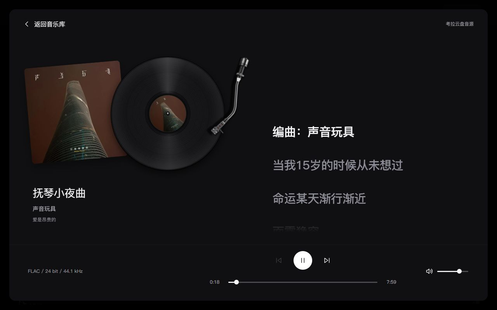
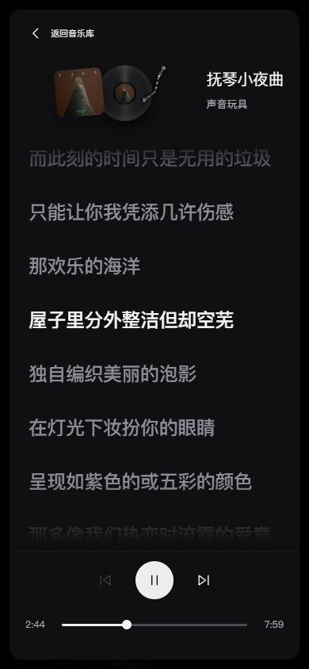

# P13 唱臂落针、封面圆标与黑胶材质

- P13 / U12 / R04、R12 / T25.09；2026-10-13。
- 用户指出播放时唱臂未落到唱片，并要求中心显示专辑封面、改善黑胶质感。覆盖旧−5°→33°固定角度，保留T25.08歌词、曲库、封套和唯一audioSession。
- 主技能frontend-design：沿用SYSTEM黑灰、苹方与既有器物构图；视觉重点只在黑胶沟槽、侧光与封面，不新增主题、字体或渲染依赖。
- 复用Vinyl Vue现有唱臂WebP，按原图枢轴/唱针坐标求圆交点，播放从外圈向内圈、暂停归位；响应式使用同一等比甲板坐标系。
- 中心圆标读取当前track.coverUrl，复用AlbumArtwork缺失/失败回退，不使用演示贴纸；表面采用细沟槽SVG、固定方向反光和轻薄盘缘，保留原作者署名。
- 当前本地实现/执行者验证完成，未提交、推送或部署；用户审美与真机分别验收。

## 实现与验证

原来播放从负角起步，唱针仍朝盘外；不同手机样式还分别调整盘/臂尺寸，无法保持落针关系。本轮统一甲板等比坐标、测量原图枢轴与唱针，用圆交点求外圈→内圈角度。只消费真实playing/progress，没增加音频或模拟时钟；现有封套、曲库、歌词与推荐保留。

中心圆标改为当前专辑真实封面，保留AlbumArtwork已有失败/缺失回退。新record-surface.svg为7071B，原record.svg完整保留；细沟槽、轻薄盘缘与不随唱片转动的固定方向反光分层，封面/沟槽在播放时20秒一周。现有唱臂素材与构图仍按Vinyl Vue CC BY-NC 4.0署名，详情见REFERENCES和随站attribution.txt。

- 3项几何测试通过：全进度沟槽范围/单调向内、暂停盘外/等比缩放、无效进度安全落点。
- 音乐专项Astro check：21文件、0错误/警告/提示。最终生产构建15HTML/Pagefind通过；既有大分块及404冲突提示保留，不称全仓零警告。
- 真实考拉FLAC播放，1280×800实际CSS矩阵读回唱针半径/唱片半径：18.35秒=.8964、268.98秒=.6269、476.07秒=.4042；均在沟槽环内且向内移动。实际进度理论值与渲染读回最大误差<.0005（React媒体更新与亚像素取整），不只检查style角度。
- 点击唱臂暂停，paused=true、angle=−15°、停转，唱针半径比1.4507在盘外；再点击唱臂恢复播放/实际seek均有效。
- 390×844与320×740实际播放：落点半径比.7382/.7061、封面加载且与封套一致，无横向溢出，320px唯一audio=1。默认视口恢复；控制台error=[]；结束时暂停。
- 切换至另一真实专辑《劳动之余》，中心alt/图像与封套更新一致，播放8.65秒、落点.9050；不回填参考贴纸。
- 初批桌面沟纹缩小出现波纹，集中降低纹理密度；反光颜色简写无效，修为有效八位RGBA。最终截图/计算样式确认反光gradient有效且transform=none。初次检查脚本的parseFloat在只读执行域未提供，未改变网页，改Number.parseFloat后读回；这些失败没有记成初批全绿。
- 减少动画沿用CSS停转，并使唱臂立即落位；本轮未实测系统偏好/真机，也未重新启动网易云平台音频或改许可索引。

现有[61173预览](http://127.0.0.1:61173/personal-homepage/music/?mode=cloud)已更新。[原始浏览器数据](evidence/u12-p13-2026-10-13-vinyl-detail/browser-checks.json)保留初批和最终值；共享工作区未整体提交，未触及首页或音源服务。下一步仅待用户审美反馈，不扩展其他功能。

