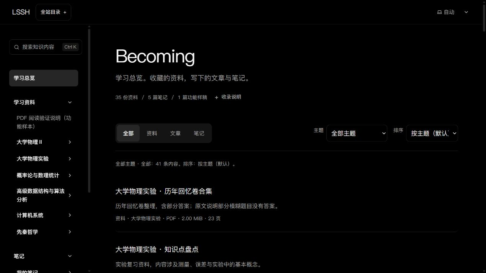
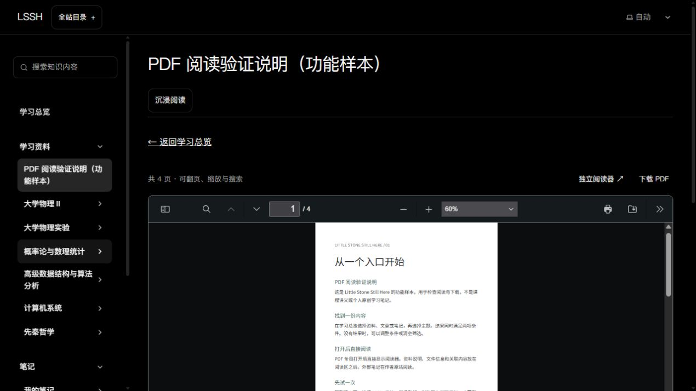

# Becoming 功能整理与发布（2026-10-15）

用户已明确要求“整理一下becoming的功能并发布”，授权将已完成切片通过现有 PR 发布。范围 P03/P05/P06/P15/P17，R02/R09/R10/R12/R13，U09/U13/U14，T05–T10/T13/T16/T26–T27。

## 发布范围

- [功能清单](../BECOMING_FEATURES.md)统一记录访客能力、编辑流程、真实内容与公开边界。
- PR [#57](https://github.com/0ne-small-stone/personal-homepage/pull/57)包含总览、PDF与文章外壳、文章列表短摘要及文章/PDF自动续读；实现追溯 df30efd、f1e7347、dc5339c、71ae907、80c539b、c19bf4a。
- 合并前接续正式主分支 e953b96：保留已上线 Someone 和首页性能等更新。工作区内其他聊天未提交的候选不参与本次发布；解决冲突时保留双方测试与设计记录。
- 正式页面只有公开四页 PDF 样本；36份本地原件不会进入构建/上传。无伪造文章或临时分页样本，保留草稿排除和附件未接入提示。

## 验证与发布门槛

已通过受保护 PR 和 Squash 合并；正式提交 `4cf7f16594f24b6c946737a856f74a984c56afe8`，main 的检查、构建及 Pages 部署均成功，见[正式发布流水线](https://github.com/0ne-small-stone/personal-homepage/actions/runs/38694685725)。

原逐片桌面/320px/390px、主题、过滤返回、分页隔离、续读与沉浸记录在 docs/design/iterations 中保留；手机真机、跨设备同步和 PDF 公开许可不在通过范围。

## 实际结果

- 集成源 head c1b30303e05ee49c8c68c024d9a28ab3bdbf1de8 的[PR检查](https://github.com/0ne-small-stone/personal-homepage/actions/runs/38694369909)三项成功后合并。首页/Someone/音乐源码与当时正式main保持，不整合其他聊天未提交候选。
- 本机公开快照：153文件检查零错误/零警告、8条既有图库提示；97功能测试与7仓库检查器测试成功；54页面/Pagefind55HTML，656静态文件、32,905,065字节。产物、目录和PDF公开校验及9组反向防护成功，无本地附件。初次受限环境的CommonJS加载失败保留说明，正常本机环境重试同一源码通过；远程独立安装亦通过。
- 公网HTTP：总览、文章列表/标签/正文、公开PDF页面及附件、未接入资料、首页和Someone共9项通过；PDF65,959字节/SHA256 9e2aac37f32cc56aff3a15434a525659c95096d4481c8739c7ee9471fca953be一致。
- 实际IAB：刷新后读到Becoming新外壳，35资料/5笔记/1样稿且无横向溢出；文章筛选只有1条；公开PDF原生阅读器完成4页加载，不再显示快捷键说明；本轮控制台error为空。初次两次浏览器调用超时，恢复后取得新版，未将旧缓存画面当作部署结果。
- 公网本轮未重跑全部续读、沉浸、分页及手机交互；其逐片本机证据和真机边界保留，不扩写成全套公网通过。36份课程原件仍只在本地，本次未上传。

[正式体验](https://0ne-small-stone.github.io/personal-homepage/knowledge/) · [文章列表](https://0ne-small-stone.github.io/personal-homepage/knowledge/blog/) · [公开PDF](https://0ne-small-stone.github.io/personal-homepage/knowledge/resources/reading-guide/)

操作：总览切换资料/文章/笔记并组合主题；文章列表打开样稿阅读后退出、再次进入验证续读；PDF样本翻页后退出再进入验证页码与页内位置，点击沉浸后Esc退出。当前记录以本次实际覆盖范围为准，验收不替代用户反馈。

[公网HTTP结果](evidence/becoming-release-2026-10-15/live-http.json) · [实际浏览器记录](evidence/becoming-release-2026-10-15/browser-checks.json) · [Pages任务](evidence/becoming-release-2026-10-15/pages-jobs.json)
