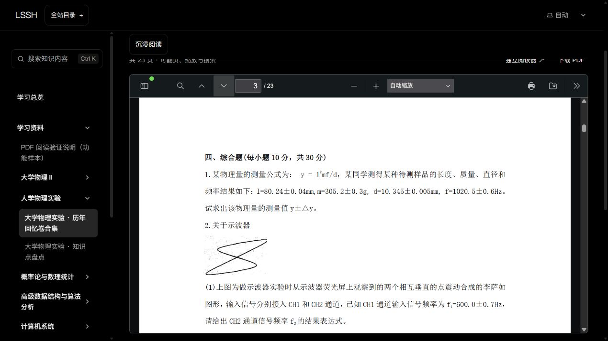

# P05 学习资料线上接入（2026-10-16）

范围：P03/P05 / R02、R09、R12 / U09、U14 / T06、T08、T16、T26–T27。

现有正式页能显示条目，但只有一个公开PDF样本，36份课程PDF仍在本地；用户要求接入资料。本片只连接附件，不重新设计页面、改分类或新增课程/图谱。

候选采用单独Release资产、固定清单及构建前验证到同源materials目录，保持900MiB产物预算、50MiB源码仓库约定、原件及已有阅读交互。完整文件与公开目的地见[可审阅范围](../LEARNING_MATERIALS_PUBLICATION.md)。

自动审批拒绝了公开上传，认为现有简述尚未明确授权36份具体PDF及公开GitHub目的地；操作未执行。当前候选仅作本机验证，等待明确范围后再上传/PR/部署。不能将本机可阅读写成正式接通。

## 本机验证完成

- 本机候选源码56e7dcf；36份原件532,587,967字节逐份校验，37份PDF（含既有公开样本）的源/产物字节与SHA256匹配。原始文件不变、二进制不进入Git。
- 新附件防护测试5/5、仓库检查器7/7通过；153文件Astro检查零错误/零警告，8条既有图库提示。54页面/Pagefind55HTML；692文件565,537,440字节，未超过900MiB。10组PDF反向防护成功，包括未登记附件。
- 本机HTTP36路径长度/200均通过，23页试卷和206.36MiB教材的32字节范围请求206通过。
- 实际IAB：23页试卷完成渲染；两次原生下一页到第3页，真实页面顶部约38.33px；刷新回到第3页，顶部约37.67px。494页/216,380,449字节大教材完成渲染。原生页码框的工具fill/Enter初次没有改变真实页，不算通过；iframe DOM读取限制如实保留。
- 大教材一次既有MutationObserver异常保留，来源尚未定位，本片未改阅读器/沉浸运行源码，不冒称控制台无错误；手机和全套沉浸未重测。
- [本机试卷入口](http://127.0.0.1:4416/personal-homepage/knowledge/resources/physics-lab/physics-lab-recalled-exams/)。预览仅监听127.0.0.1，机器重启后需重新启动；正式网址保持之前已发布版本。

[实际浏览器记录](evidence/t08-p05-2026-10-16-materials-online/browser-checks.json) · [本机HTTP](evidence/t08-p05-2026-10-16-materials-online/local-http.json) · [全部37份产物校验](evidence/t08-p05-2026-10-16-materials-online/public-pdf-check.json)

## 剩余唯一发布门槛

需用户明确授权[清单](../LEARNING_MATERIALS_PUBLICATION.md)内具体36份PDF公开上传到0ne-small-stone/personal-homepage的GitHub Release并在正式网站供所有访客阅读/下载，或另选允许公开的子集。自动审批拒绝的上传没有执行；不得换入口或脚本绕过。获准后仍需上传校验、三项PR检查、正式Pages成功与公网读回，才能写成已接通。

### P05 36份PDF公开范围已明确授权（2026-10-16）

用户针对具体文件、公开GitHub Release目的地与全体访客阅读/下载范围回复“ok 允许”。现授权清单中全部36份PDF公开上传并通过既有PR/Pages流程上线，不含两个TXT或其他本机数据。原先自动审批拒绝为授权前历史；继续原候选，不更换公开范围、不重复询问。发布成功仍以资产校验、三项PR检查、Pages任务及正式阅读入口为准。
