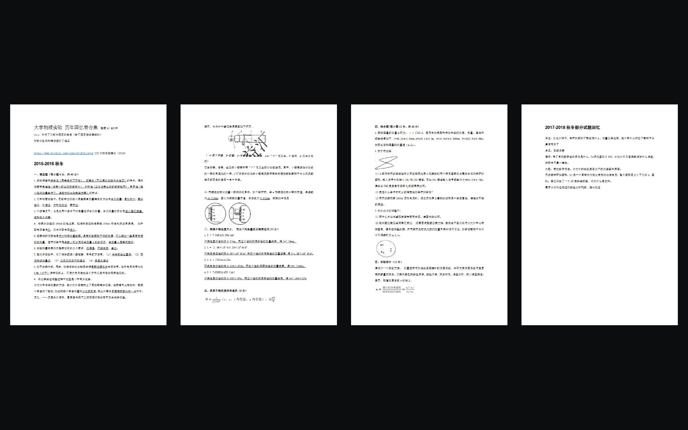

# P05 PDF 加载与沉浸快捷键修复（2026-10-16）

范围：P03/P05 / R02、R09、R12 / U09、U14 / T08、T09、T26–T27。用户反馈加载过慢，且明确进入沉浸后1、2、3、4、F仍无效。本片延续已上线的36份资料和现有Becoming外观，附件原件、分类、续读和退出方式保持。

## 实现

- 保留固定PDF.js 6.4.299上游源码和Apache许可，以现有esbuild生成四个压缩运行文件；不增加依赖，不把生成文件加入Git。构建和开发入口先准备这些文件。原运行脚本3,892,255字节，压缩后2,138,241字节，减少1,754,014字节（45.06%）。
- 独立启动配置在PDF.js保存偏好读取后、initialize继续前设置worker/sandbox压缩路径。≥4MiB附件同时关闭自动预取与连续下载，保留范围请求；小文件保留单流。未知大小的独立阅读器也按需加载。不关闭阅读历史/偏好，不借debug URL启用选项。
- 快捷键在父页与PDF自己的Window捕获，补上IME吞掉keydown后的keyup和旧式keyCode回退。正常keydown/keyup不重复执行；可见表单保持输入，隐藏PDF工具栏焦点不吞键，离页/iframe重载撤监听。1–4固定、0及5–9解除固定、F适配、Ctrl缩放、Esc/右滑退出保持。

## 执行验证

- 22项定向测试通过：输入/IME释放/焦点/卸载、加载配置与偏好次序、阅读器就绪、续读状态、布局/混合纸张/物理按键。首次测试发现Node导入扩展名和中止后监听残留，修复后通过；失败过程不记通过。
- Astro检查158文件零错误/零警告；首轮多出一项兼容keyCode的弃用提示，已使用显式兼容类型限定，不改变行为。静态候选54页/Pagefind54HTML构建成功；仅省略再次复制532MB公开静态附件，本机服务将同一public目录叠加到构建结果，未替换其他dist。
- 实际IAB原生键盘：1/2/3/4各自得到对应columns；四页下Ctrl减号两次仍为4列，缩放从0.4经F恢复为约0.65293，四张完整显示；0与9解除固定，Esc退出。见[原始结果](evidence/t08-pdf-2026-10-16-speed-shortcuts/candidate-keyboard.json)和下图。
- 同一本216,380,449字节/494页教材、同一回环HTTP夹具、Cache-Control:no-store，实际canvas首屏完成后：旧策略2请求/216,426,562传输字节，按需策略8请求（7个206）/2,208,801字节。此为服务端已读入流的字节（含少量缓冲），不当作网络首屏秒数；[逐请求记录](evidence/t08-pdf-2026-10-16-speed-shortcuts/transfer-before-after.json)。后续原生输入尝试跳494，输入框留471，实际494页canvas已绘制且top39.33px；如实区分工具输入框值与真实可见页，见[远页截图](evidence/t08-pdf-2026-10-16-speed-shortcuts/candidate-range-last-page.jpg)。

## 边界与发布

旧正式版原生英文2键在本机可用，未声称完整复现用户操作系统输入法失效。新候选已用真实英文按键验证；中文Process/物理键/旧式/keyup与焦点场景用回归夹具验证，未切换操作系统输入法。手机真机、完整手势与所有附件逐页未重测。原生locator.press在旧远程页曾退出全屏，未计入通过，后续使用当前焦点的原生键盘。

独立dev进程启动未完成，已停止核对过的本轮进程并改用静态构建验证；旧失败标签不交用户。Git传输连续连接重置，发布可使用同仓库Git API，必须先比对本地父树与当前main树、写入树与已测本地树，限制本片文件清单，仍通过三项受保护检查和正式Pages；不直推main或降低保护。正式PR/发布及公网复验另补，不把本机通过记为已上线。

加载配置依据：[PDF.js官方API](https://mozilla.github.io/pdf.js/api/draft/module-pdfjsLib.html)中disableAutoFetch/disableStream的配合要求，2026-10-16读取；具体执行顺序同时核对本仓库固定viewer源码并以真实范围请求验证。交互规则按现有ui-ux-pro-max的键盘/焦点要求定向使用，不另建视觉规范。
